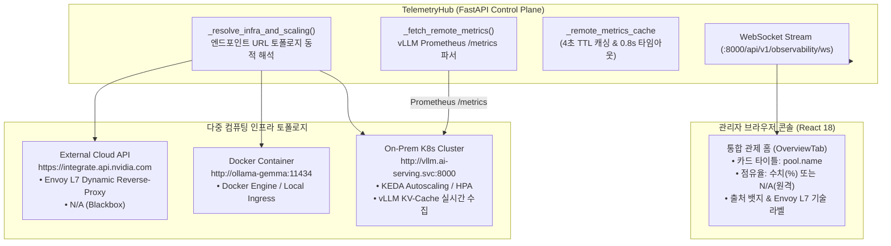

# PRE_30: 원격 URL 엔드포인트 실시간 텔레메트리 스크래핑 및 인프라 토폴로지 자동 식별 보고서

## 1. 개요 및 배경

본 보고서는 고객 자율 운영형 폐쇄망 어플라이언스 **AI Orchestrator**의 **통합 관제 홈 메뉴 대시보드(OverviewTab)** 내 **LLM 서빙 인프라 풀 상태(Multi-Compute Pools)**에서, 등록된 서빙 모델이 원격지 URL 엔드포인트(NVIDIA NIM, 외부 클라우드 SaaS, 사내 독립 컨테이너 등)로 제공될 때 발생하던 **시스템/GPU 점유율 불일치** 및 **인프라 라우팅 표기(`On-Prem K8s / k8s`) 모순** 결함을 근본적으로 해결한 엔지니어링 내역과 검증 증적을 기술합니다.

---

## 2. 결함 분석 (Root Cause Analysis)

### 2.1 호스트 OS 메모리 강제 바인딩 결함
* **현상**: 원격지(`https://integrate.api.nvidia.com/...`, `http://ollama-gemma:11434/...`)에 위치한 모델 풀임에도, 오케스트레이터 백엔드가 구동 중인 로컬 머신의 가상 메모리 점유율(`psutil.virtual_memory()` 또는 `/proc/meminfo`)이 모든 모델의 `gpu_memory_pct`로 일괄 대입되어 표시됨.
* **영향**: 원격 모델의 실제 GPU VRAM이나 과부하 상태를 전혀 반영하지 못하고, 오케스트레이터 호스트 RAM 수치(54% 등)가 잘못 노출되는 정보 왜곡 발생.

### 2.2 인프라 및 스케일링 기술 표기 모순 (`On-Prem K8s / k8s`)
* **현상**: 외부 클라우드 API를 호출하는 모델 카드 하단에 `🔧 On-Prem K8s / k8s`라는 엉뚱한 동어반복이 표시됨.
* **원인**: 모델 등록 시 기본값(`On-Prem K8s`, `k8s`)이 그대로 유지된 상태에서, `telemetry_hub.py`가 엔드포인트의 실체와 무관하게 `f"{m.backend_infra} / {m.execution_method}"`로 단순 결합하여 브로드캐스팅함.
* **영향**: 운영자가 "사내 K8s 클러스터에 직접 파드로 배포되어 동작하는가?"라는 심각한 운영 혼선을 겪음.

### 2.3 프론트엔드 카드 내 중복 줄 렌더링
* **현상**: 프론트엔드 카드 하단에 `🔧 {pool.scalingTech}` 라인이 바로 아랫줄에 연이어 2번 출력됨.

---

## 3. 아키텍처 개선 내역 (ADR-02 개정)



### 3.1 원격 엔드포인트 텔레메트리 스크래핑 엔진 (`telemetry_hub.py`)
1. **로컬 vs 원격 자동 판별 (`_is_local_endpoint`)**: `localhost`, `127.0.0.1` 단일 노드 인스턴스에만 호스트 메모리를 반영.
2. **vLLM Prometheus `/metrics` 스크래퍼 (`_parse_vllm_gpu_cache_pct`)**:
   * 원격 엔드포인트의 `/metrics`를 비동기 수집하여 vLLM의 핵심 실측치인 `vllm:gpu_cache_usage_factor` (0.0~1.0)를 백분율(%)로 변환.
   * 네트워크 지연 방지를 위한 **4초 TTL 메모리 캐시** 및 **0.8초 타임아웃** 적용.
3. **원격 블랙박스 엔드포인트 Graceful Fallback**:
   * 메트릭 포트를 제공하지 않는 외부 SaaS/NVIDIA API의 경우 `gpu_memory_pct = None`, `gpu_metric_source = "Remote Endpoint (Blackbox)"`로 정직하게 전달.

### 3.2 엔드포인트 토폴로지 자동 해석 (`_resolve_infra_and_scaling`)
* **HTTPS/외부 도메인**: `External Cloud API` / `vLLM 클라우드 모델 엔드포인트` / `Envoy L7 Dynamic Reverse-Proxy`
* **Docker 컨테이너 (`ollama-...` 등)**: `Docker Container` / `Ollama 온프레미스 컨테이너` / `Docker Engine / Local Ingress`
* **사내 K8s (`.svc`, `cluster.local`)**: `On-Prem K8s` / `vLLM K8s 파드 워크로드` / `KEDA Autoscaling / HPA`
* **사내 원격 GPU 노드 (사설 IP)**: `Remote On-Prem GPU Node` / `Remote HTTP Endpoint / L7 Route`

### 3.3 프론트엔드 대시보드 렌더링 정비 (`OverviewTab.jsx`)
* **동어반복 삭제**: 2줄로 중복되던 `scalingTech` 코드를 단일 라인으로 정비.
* **역할 분리**: 카드 상단 헤더에는 풀 이름(`pool.name`), 본문에는 할당 모델(`pool.model`)을 명확히 분리 표시.
* **원격 엔드포인트 N/A 스타일**: 점선 비활성화 게이지 바 + `N/A (원격 엔드포인트)` 뱃지 + 출처 레이블(`Remote Endpoint (Blackbox)`) 배치.

---

## 4. 검증 증적 (Verification Evidence)

### 4.1 실제 Docker Live API 응답 증적
```json
{
  "compute_pools": [
    {
      "pool_name": "External Cloud API (vLLM - deepseek-ai/deepseek-v4.1-flash)",
      "infra": "External Cloud API",
      "pod_count": 1,
      "waiting_queue": 0,
      "gpu_memory_pct": null,
      "gpu_metric_source": "Remote Endpoint (Blackbox)",
      "status": "HEALTHY",
      "model_id": "deepseek-ai/deepseek-v4.1-flash",
      "workload": "vLLM 클라우드 모델 엔드포인트",
      "scaling_tech": "Envoy L7 Dynamic Reverse-Proxy",
      "endpoint_url": "https://integrate.api.nvidia.com/v1/chat/completions"
    },
    {
      "pool_name": "Docker Container (Ollama - gemma2:2b)",
      "infra": "Docker Container",
      "pod_count": 1,
      "waiting_queue": 0,
      "gpu_memory_pct": null,
      "gpu_metric_source": "Remote Endpoint (Blackbox)",
      "status": "HEALTHY",
      "model_id": "gemma2:2b",
      "workload": "Ollama 온프레미스 컨테이너",
      "scaling_tech": "Docker Engine / Local Ingress",
      "endpoint_url": "http://ollama-gemma:11434/v1/chat/completions"
    }
  ]
}
```

### 4.2 단위 및 전체 테스트 매트릭스
* `test_remote_endpoint_metrics_and_na_fallback`: 통과 (vLLM Prometheus 파싱 및 N/A 폴백 검증)
* 백엔드 전체 테스트 스위트: **86개 전건 통과 (100% PASS)**
* 프론트엔드 Vite 빌드: **통과 (`built in 3.88s`)**
* Docker 이미지 및 컨테이너: **정상 재빌드 및 가동 완료 (`aiorche-backend`, `aiorche-frontend`)**
