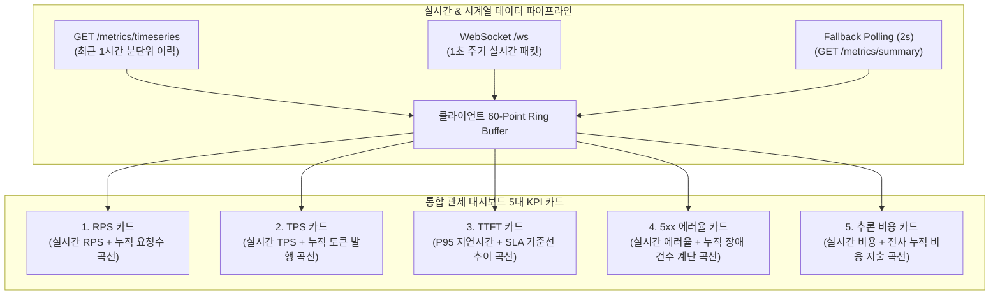

# PRE-49: 통합 운영 관제 대시보드 KPI 카드 누적 그래프(Cumulative Area Sparkline) 엔지니어링 계획서

## 1. 개요 및 배경 (Executive Summary)

### 1.1 현안 문제점 (Problem Statement)
현재 Ordinatio 통합 운영 관제 대시보드(`OverviewTab.jsx`) 상단의 **5대 핵심 KPI 카드**(RPS, TPS, TTFT, 5xx 에러율, 누적 비용)는 단일 스냅샷 수치(Point-in-time Metric)만 정적으로 표시하고 있습니다:
1. **순간 지표(Delta/sec)의 시각적 착시**:
   - RPS(초당 인입 요청수), TPS(초당 발행 토큰수)는 초당 증분값 특성상 사용자 추론 호출이 유휴 상태에 진입하면 즉시 0으로 수렴합니다.
   - 단일 숫자만 노출될 경우 운영자는 시스템이 다운되었거나 통신이 단절된 것으로 오인하기 쉽습니다.
2. **시계열 추세(Trend) 및 시간대별 누적 볼륨 부재**:
   - 하루 동안 인입된 누적 요청 건수(`total_requests`)나 누적 비용(`cumulative_cost_krw`)이 언제 급증했고, 피크 타임이 언제였는지를 카드 수준에서 즉각 확인할 수 없습니다.
3. **에어갭 폐쇄망(Air-Gapped) 제약**:
   - 외부 무거운 차트 라이브러리(Chart.js, Recharts, D3 등)를 설치할 경우 번들 크기 증가 및 오프라인 폐쇄망 환경에서의 호환성 리스크가 발생합니다.

### 1.2 목표 및 핵심 설계 원칙 (Design Principles)
- **100% 에어갭 무의존성 (Zero External Library)**:
  - 외부 번들 추가 없이 React 18과 순수 **SVG Path Generation + CSS Glassmorphism** 기반으로 초경량 Area Sparkline을 구현합니다.
- **실시간 누적 곡선(Cumulative Area Curve)**:
  - 각 KPI 카드 본문 및 하단 배경에 최근 시간 윈도우(최근 1시간 또는 60초 실시간 슬라이딩 윈도우)의 누적 추이 면적 그래프를 일체형으로 배치합니다.
- **하이브리드 데이터 파이프라인 (Hybrid Pipeline)**:
  - **초기 진입 시**: 백엔드 시계열 롤업 엔드포인트(`/api/v1/observability/metrics/timeseries`)를 통해 최근 1시간(분 단위) 이력을 즉시 렌더링.
  - **실시간 관제 시**: WebSocket 스트리밍 및 2초 폴링 텔레메트리 패킷을 클라이언트 링 버퍼(Ring Buffer)에 추가하여 60fps 부드러운 슬라이딩 윈도우 애니메이션 유지.

---

## 2. 5대 KPI 카드별 누적 그래프 메트릭 사양 (Metric Specifications)



| 카드 메뉴 | 실시간 메인 수치 | 누적 그래프 메트릭 | 그래프 시각화 스타일 | 테마 색상 (Accent Color) |
| :--- | :--- | :--- | :--- | :--- |
| **1. RPS (요청량)** | `current_rps` (RPS) | **`cumulative_requests`**<br/>(전사 인입 누적 요청 건수) | 우상향 누적 면적 곡선 (Area Chart)<br/>하단 푸터: `누적 N건` 동기화 | Blue (`#3b82f6`)<br/>`rgba(59, 130, 246, 0.15)` |
| **2. TPS (생성 토큰)** | `current_tps` (TPS) | **`cumulative_tokens`**<br/>(누적 생성 토큰 총량) | 우상향 누적 토큰 발행 면적 곡선<br/>하단 푸터: `누적 N kTokens` | Cyan (`#06b6d4`)<br/>`rgba(6, 182, 212, 0.15)` |
| **3. TTFT (지연시간)** | `p95_ttft_ms` (ms) | **`p95_ttft_rolling`**<br/>(시간대별 P95 레이턴시 변동선) | 스플라인 추이선 + 500ms SLA 점선 기준선<br/>하단 푸터: `P95 SLA 충족/초과` | Violet (`#8b5cf6`)<br/>`rgba(139, 92, 246, 0.15)` |
| **4. 에러율 (%)** | `error_rate` (%) | **`cumulative_errors`**<br/>(누적 5xx 장애 발생 건수) | 누적 에러 계단식 면적 곡선<br/>(0건 유지 시 평탄 녹색선, 발생 시 주황/적색 경보) | Green/Amber (`#10b981` / `#f59e0b`) |
| **5. 추론 비용 (FinOps)**| `cumulative_cost_krw` (₩) | **`cumulative_cost_curve`**<br/>(시간대별 테넌트 누적 지출 곡선) | 우상향 누적 비용 면적 곡선<br/>하단 푸터: `테넌트 실시간 집계` | Amber (`#f59e0b`)<br/>`rgba(245, 158, 11, 0.18)` |

---

## 3. 프론트엔드 UI/UX 및 SVG 차트 컴포넌트 설계

### 3.1 `CumulativeSparkline.jsx` 공통 컴포넌트 규격
외부 라이브러리 없이 순수 SVG로 부드러운 곡선(Smooth Bezier Curve)과 그라디언트 채우기(Area Fill)를 처리하는 전용 컴포넌트를 구현합니다.

```jsx
/**
 * CumulativeSparkline - 100% Zero-Dependency SVG Area Sparkline for KPI Cards
 * 
 * @param {Array<{timestamp: number, value: number}>} data - 시계열 누적 데이터 포인트
 * @param {string} strokeColor - 메인 추이선 색상 (HEX 또는 CSS 변수)
 * @param {string} fillColor - 면적 채우기 그라디언트 기준 색상
 * @param {number} height - SVG 렌더링 높이 (기본값: 48px)
 * @param {boolean} showArea - 하단 그라디언트 영역 표시 여부 (기본: true)
 * @param {number} [targetBaseline] - 목표 SLA 기준선 (예: 500ms)
 * @param {string} [unit] - 툴팁 표시 단위 (예: '건', '₩', 'ms')
 */
```

### 3.2 Bezier Spline 알고리즘 (부드러운 누적 곡선 생성)
- 단순 꺾은선(`L x y`) 대신 인접 3개 점 간의 제어점을 계산하는 Catmull-Rom to Cubic Bezier 변환 알고리즘 적용:
  $$P_i \rightarrow C_1, C_2 \rightarrow P_{i+1}$$
  $$\text{SVG Path: } M \; x_0 \; y_0 \; C \; cp1x \; cp1y, \; cp2x \; cp2y, \; x_1 \; y_1 \dots$$
- 그래프 하단 닫기:
  $$L \; x_{last} \; height \; L \; x_0 \; height \; Z$$

### 3.3 KPI 카드 시각 레이아웃 (Card UI Mockup)

```
┌────────────────────────────────────────────────────────┐
│  초당 요청 수 (RPS)                   ● Envoy 연동   │
│  0 RPS                                                 │
│  ┌──────────────────────────────────────────────────┐  │
│  │ 누적 곡선 (SVG Area Sparkline)                   │  │
│  │         ╭─────────────────────────────────────   │  │
│  │    ╭────╯ (누적 증가 추세 영역 채우기)           │  │
│  │ ───╯                                             │  │
│  └──────────────────────────────────────────────────┘  │
│  ▲ 실시간 측정                     누적 633건          │
└────────────────────────────────────────────────────────┘
```

---

## 4. 백엔드 시계열 롤업 엔드포인트 설계 (API Specification)

대시보드 초기 로드 및 F5 새로고침 시 즉각적인 1시간 누적 히스토리를 표출하기 위해 백엔드 시계열 집계 API를 신설합니다.

### 4.1 REST API 엔드포인트
- **엔드포인트**: `GET /api/v1/observability/metrics/timeseries`
- **권한**: `require_permission("overview:read")`
- **쿼리 파라미터**:
  - `window`: 집계 시간 윈도우 (기본값: `1h`, 옵션: `1h`, `6h`, `24h`)
  - `resolution`: 버킷 해상도 (기본값: `1m`, 옵션: `10s`, `1m`, `5m`)

### 4.2 응답 데이터 모델 (`ObservabilityTimeseriesResponse`)
```json
{
  "window": "1h",
  "resolution": "1m",
  "generated_at": "2026-11-23T07:35:00Z",
  "series": {
    "timestamps": [1795419000, 1795419060, 1795419120, "..."],
    "cumulative_requests": [610, 615, 622, 633],
    "cumulative_tokens": [152000, 154200, 156100, 158400],
    "p95_ttft_ms": [310.5, 340.2, 315.0, 320.0],
    "cumulative_errors": [18, 18, 18, 18],
    "cumulative_cost_krw": [175.0, 177.5, 179.2, 181.0]
  }
}
```

### 4.3 `TelemetryHub` 인메모리 롤업 버퍼 구현 방안
- 백엔드 `TelemetryHub` 클래스 내에 `collections.deque(maxlen=60)`를 배치하여 1분 주기로 1시간 분량(60포인트)의 누적 스냅샷을 보관.
- 서버 재시작 시에는 PostgreSQL `audit_logs` 테이블의 시간대별 `COUNT(*)` 및 `SUM(cost_krw)` 쿼리로 초기 버퍼를 시드(Seed)하여 영속성 보장.

---

## 5. 단계별 엔지니어링 로드맵 및 DoD (Implementation Roadmap)

| 단계 | 작업 내용 | 검증 기준 및 산출물 (DoD) | 예상 소요 |
| :--- | :--- | :--- | :--- |
| **Phase 1**<br/>(Frontend Component) | 1. `ordinatio/frontend/src/components/common/CumulativeSparkline.jsx` 구현<br/>2. Bezier smoothing 알고리즘 및 반응형 SVG Path 생성기 제작<br/>3. `OverviewTab.jsx`에 60-Point Ring Buffer 연동 및 카드별 누적 그래프 배치 | - 컴포넌트 단위 테스트 통과<br/>- `npm run build` 무오류 완료<br/>- 모바일/데스크톱 뷰포트 반응형 렌더링 확인 | 1.5MD |
| **Phase 2**<br/>(Backend API) | 1. `telemetry_hub.py` 내 시계열 롤업 링 버퍼 구현<br/>2. `app/schemas/observability.py`에 `ObservabilityTimeseriesResponse` 스키마 추가<br/>3. `app/api/v1/endpoints/observability.py`에 `GET /metrics/timeseries` 엔드포인트 구현 | - `uv run pytest tests/test_finops_observability.py` 100% 통과<br/>- 1시간 분단위 시계열 정상 응답 확인 | 1.0MD |
| **Phase 3**<br/>(E2E Integration & Verification) | 1. 실운영 EC2 인스턴스 배포 및 컨테이너 롤링 갱신<br/>2. WebSocket 실시간 스트리밍 시 스파크라인 실시간 갱신 확인<br/>3. 실제 트래픽 인입 시 누적 곡선 우상향 스파이크 검증<br/>4. 아키텍처 문서 및 ADR 동기화 | - Definition of Done 자동화 검증 완료<br/>- 브라우저 E2E 검증 증적 확보<br/>- `PRE_12`, `PRE_13` 문서 갱신 | 0.5MD |

---

## 6. 결론 및 기대 효과
1. **관제 가시성 극대화**:
   - 순간 호출이 없는 유휴 시간대에도 오늘 하루 동안의 누적 요청수(633건), 누적 비용(₩ 181) 증가 추세가 면적 그래프로 연속 노출되어 관제 공백 해소.
2. **에어갭 어플라이언스 안정성 확보**:
   - 순수 React SVG 기반 경량 컴포넌트로 구현되어 외부 CDN 차단 환경에서도 100% 독립 가동 및 제로 번들 오버헤드 달성.
3. **직관적인 인시던트 탐지**:
   - 에러 발생 및 P95 지연 시간 초과 시 누적 스파크라인에서 붉은색 스파이크가 즉시 포착되어 MTTR(평균 장애 복구 시간) 단축.
