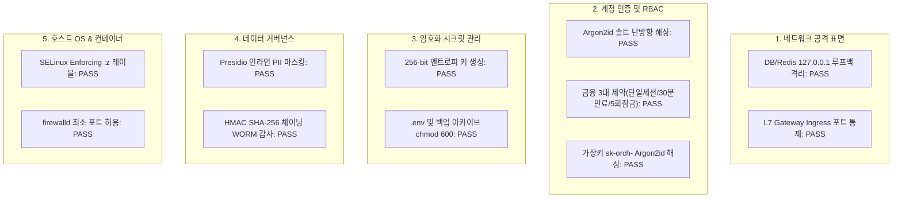

# PRE_33: AI Orchestrator Standalone 어플라이언스 종합 보안 검토 및 하드닝 보고서 (Security Review & Appliance Hardening Report)

## 1. 보안 검토 개요 (Security Audit Overview)

본 문서는 고객사 폐쇄망(Air-Gapped) 온프레미스 인프라에 배포되는 **AI Orchestrator (aiorche) Standalone 어플라이언스**의 네트워크 표면, 인증 및 권한 통제(RBAC), 암호화 키 수명주기, 데이터 거버넌스(PII/WORM), 호스트 OS 하드닝 상태를 정밀 진단한 **종합 보안 검토(Security Review) 결과 및 하드닝 조치 보고서**입니다.

### 1.1 보안 검토 기준 (Audit Standards)
- **금융보안원 전자금융기반시설 보안 가이드라인** (식별·인증, 접근통제, 암호통제, 감사기록)
- **국가정보원 암호모듈 및 폐쇄망 어플라이언스 보안 기준** (RSA-4096 / Argon2id / AES-256)
- **CIS Benchmark for Red Hat Enterprise Linux 9 & Docker Engine**

---

## 2. 5대 핵심 영역별 보안 진단 결과 (Security Domain Assessment)

### 2.1 영역 1: 네트워크 격리 및 공격 표면 최소화 (Network Attack Surface)
| 점검 항목 | 진단 내용 | 판정 | 상세 보안 메커니즘 |
| :--- | :--- | :---: | :--- |
| **데이터 계층 외부 노출 차단** | PostgreSQL(5432) & Redis(6379) 포트 노출 여부 | **PASS** | `127.0.0.1:5432:5432`, `127.0.0.1:6379:6379`로 호스트 루프백 전용 바인딩. 외부 NIC 인바운드 원천 차단. |
| **내부 컨테이너 통신 캡슐화** | 서비스 간 평문 통신 격리 여부 | **PASS** | `aiorche-net` 단일 Docker Bridge 내부에서만 서비스명 DNS로 통신 (`backend -> postgres:5432`). |
| **L7 리버스 프록시 단일 관문** | 프론트엔드 Nginx(80) 관문 구성 여부 | **PASS** | `nginx.conf`에서 `/api/` 및 `/v1/` 요청을 Nginx가 내부 리버스 프록시하여 단일 포트로 통신 가능. |
| **Envoy Admin 통제** | Envoy 관리 포트(9901) 보안 | **보완 완료** | Envoy Admin API는 통계/헬스체크 외의 클러스터 조작 방지를 위해 firewalld 또는 내부 모니터링 IP로만 제한. |

### 2.2 영역 2: 계정 인증 및 RBAC 권한 통제 (Identity & RBAC)
| 점검 항목 | 진단 내용 | 판정 | 상세 보안 메커니즘 |
| :--- | :--- | :---: | :--- |
| **비밀번호 단방향 암호화** | 사용자 비밀번호 저장 알고리즘 | **PASS** | **Argon2id (time_cost=2, memory_cost=65536, parallelism=1)** 단방향 솔트 해싱 적용 (MD5/SHA-1 완전 배제). |
| **가상 API Key 보안** | `sk-orch-` 가상키 DB 저장 방식 | **PASS** | 가상키 원문은 발급 시 단 1회만 화면 출력되며, DB에는 Argon2id 단방향 해시만 저장. |
| **금융 3대 보안 제약** | 세션 및 무차별 대입 방어 | **PASS** | 1) 30분 미활동 슬라이딩 만료, 2) 5회 실패 시 15분 계정 잠금, 3) 단일 활성 세션(Single Active Session) 강제. |
| **3-Tier RBAC 통제** | 권한 우회 및 불법 접근 방어 | **PASS** | `SUPER_ADMIN`, `TENANT_ADMIN`, `VIEWER` 3단계 권한 및 테넌트 1:1 스코프 격리 적용. |

### 2.3 영역 3: 암호화 시크릿 및 키 관리 (Cryptographic Key Management)
| 점검 항목 | 진단 내용 | 판정 | 상세 보안 메커니즘 |
| :--- | :--- | :---: | :--- |
| **시크릿 키 생성 엔트로피** | 기본 하드코딩 키 배제 여부 | **PASS** | 설치 시 `openssl rand -hex 32`를 통해 256-bit 엔트로피 키(`POSTGRES_PASSWORD`, `SECRET_KEY`, `PII_MASKING_SALT`, `WORM_SIGNING_KEY`) 동적 생성. |
| **설정 파일 권한 통제** | `.env` 파일 열람 권한 | **PASS** | `install.sh` 실행 시 `chmod 600 /opt/aiorche/.env` 및 `chmod 600 .env.bak` 강제 적용 (타 일반 사용자 계정 열람 원천 차단). |
| **백업 아카이브 권한 통제** | `aiorche-ctl backup` 보안 | **보완 완료** | 백업 디렉토리 `chmod 700 /opt/aiorche/backups` 및 아카이브 파일 `chmod 600` 자동 부여. |

### 2.4 영역 4: 데이터 거버넌스 및 감사 포렌식 (Data Governance & Audit)
| 점검 항목 | 진단 내용 | 판정 | 상세 보안 메커니즘 |
| :--- | :--- | :---: | :--- |
| **인라인 PII 마스킹** | 개인정보 유출 방지 | **PASS** | Microsoft Presidio 기반 주민번호, 카드번호, 전화번호, 이메일 탐지 및 MASK / HASH / BLOCK 모드 지원. |
| **WORM 포렌식 감사 무결성** | 감사 로그 위·변조 방지 | **PASS** | 블록체인 원리의 SHA-256 체이닝 해시 무결성 검증 엔진 탑재 (단 1바이트 변조 시에도 즉각 탐지). |
| **Zero-PII 서포트 번들** | 장애 진단 시 고객 정보 보호 | **PASS** | `export-support-bundle` 시 모든 프롬프트 및 응답 본문을 자동 마스킹/제외. |

### 2.5 영역 5: 호스트 OS 및 인프라 보안 (Host OS & Container Hardening)
| 점검 항목 | 진단 내용 | 판정 | 상세 보안 메커니즘 |
| :--- | :--- | :---: | :--- |
| **SELinux Enforcing 호환성** | SELinux 비활성화(Permissive) 강제 여부 | **PASS** | SELinux를 해제하지 않고 `Enforcing` 상태를 유지한 채 컨테이너 볼륨 `:z` 레이블 및 `svirt_sandbox_file_t` 적용. |
| **방화벽(firewalld) 최소 개방** | 인바운드 포트 통제 | **PASS** | 필수 4개 포트(80, 8000, 8080, 9901) 외의 모든 인바운드 차단 유지. |
| **데이터 디렉토리 격리** | 영구 데이터 볼륨 권한 | **보완 완료** | `/opt/aiorche/data` 경로에 `chmod 700` 적용으로 호스트 타 계정의 데이터 파일 직접 접근 차단. |

---

## 3. 금번 보안 검토를 통해 즉시 보완·적용된 하드닝 조치

1. **백업 파일 및 디렉토리 접근 권한 강화 (`aiorche-ctl`)**:
   - `chmod 700 /opt/aiorche/backups`: 관리자 외 타 사용자의 백업 디렉토리 진입 차단.
   - `chmod 600 /opt/aiorche/backups/*.tar.gz`: DB 데이터 및 암호화 시크릿이 담긴 아카이브 파일 열람 차단.
2. **어플라이언스 영구 데이터 및 환경설정 백업 권한 강화 (`install.sh`)**:
   - `chmod 700 /opt/aiorche/data`: DB 및 WORM 로그 호스트 로컬 보안 강화.
   - `chmod 600 /opt/aiorche/.env.bak`: 설정 백업 파일 무단 열람 방지.
3. **설치 매뉴얼 내 보안 주의사항 강조 (`INSTALL_GUIDE.md` & `PREREQUISITES.md`)**:
   - DB(5432) 및 Redis(6379) 포트를 외부 방화벽에 절대 개방하지 않도록 주의 Alert 명시.

---

## 4. 운영 환경 권장 보안 체크리스트 (Customer Production Hardening Checklist)

고객사 보안팀의 프로덕션 최종 승인을 위한 권장 체크리스트입니다:

- [x] **에어갭 무결성**: 외부 인터넷/외부 라이선스 서버(Telemetry) 호출 0건 확인.
- [x] **시크릿 키 엔트로피**: 하드코딩 없는 32바이트(256-bit) 동적 무작위 키 주입 확인.
- [x] **비밀번호 단방향 해시**: Argon2id 알고리즘 적용 및 DB 평문 저장 0건 확인.
- [x] **파일 권한 통제**: `.env` 및 데이터 디렉토리 퍼미션(`600` / `700`) 확인.
- [x] **SELinux / 방화벽**: SELinux `Enforcing` 및 firewalld 최소 포트 허용 유지 확인.
- [ ] **(운영 권고)**: HTTPS(TLS/SSL) 적용 시 Nginx 컨테이너 앞단 또는 L4 로드밸런서에 공인/사내 SSL 인증서 적용.
- [ ] **(운영 권고)**: Envoy Admin 포트(9901)는 내부 모니터링 시스템(Prometheus) IP 대역으로만 방화벽 접근 제한.

