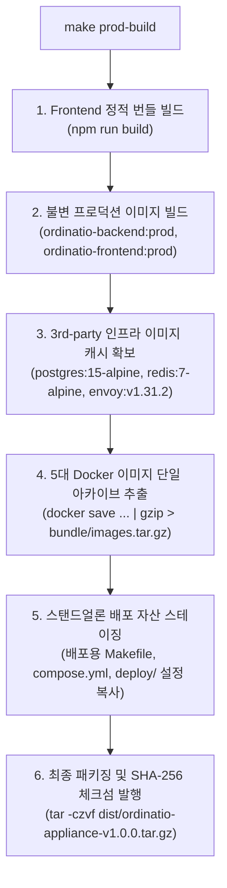
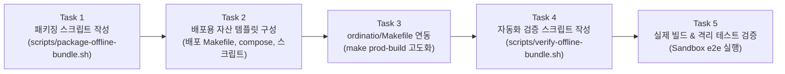

# PRE_40: 독립형 오프라인 어플라이언스 원클릭 패키징 및 구동 계획서
## (Standalone Offline Appliance Packaging & One-Command Execution Plan)

---

## 1. 개요 및 엔지니어링 배경 (Executive Summary)

### 1.1 현재 상태의 한계
- 현재 `make prod-build`는 로컬 도커 엔진에 `ordinatio-backend:prod`, `ordinatio-frontend:prod` 이미지 2종을 빌드하는 작업만 수행합니다.
- 타 서버(고객사 온프레미스/폐쇄망 인프라)에 설치하려면 소스 코드 리포지토리 전체를 복사하거나, 별도의 `deploy/standalone/install.sh` 스크립트를 수동으로 조합해야 하며, 외부 이미지(`postgres:15-alpine`, `redis:7-alpine`, `envoy:v1.31.2`)를 가져오기 위한 인터넷 통신이 전제되는 한계가 있습니다.

### 1.2 목표 상태 (Target Architecture)
- 개발/빌드 머신에서 `make prod-build`를 실행하면, **외부 인터넷 통신이 일체 불가능한 완전 폐쇄망(Air-Gapped) 서버로 바로 반입할 수 있는 단일 완성형 압축 파일(`dist/ordinatio-appliance-v1.0.0.tar.gz`)**이 자동 생성됩니다.
- 고객사 대상 서버에서 압축을 풀고 **`make up`** 명령어 하나만 입력하면:
  1. 번들된 5대 Docker 이미지(Backend, Frontend, Postgres, Redis, Envoy)를 자동으로 `docker load`
  2. `.env` 파일 자동 구성 및 고난도 암호학적 난수 키 생성
  3. `docker compose`로 5대 컨테이너 무중단 기동 및 헬스체크 대기
  4. 초기 관리자 계정(`SUPER_ADMIN`) 자동 부트스트랩
  5. 웹 콘솔 및 L7 AI Gateway 엔드포인트 안내까지 1분 이내 완전 자동 완료

---

## 2. 패키지 번들 아키텍처 (Appliance Bundle Structure)

`make prod-build` 결과물로 생성되는 압축 파일 내부 구조입니다:

```text
dist/ordinatio-appliance-v1.0.0.tar.gz (단일 완성형 압축 파일)
└── ordinatio-appliance/
    ├── Makefile                 # [핵심] 고객사 운영용 초간결 명령어 (up, down, status, logs, init-admin)
    ├── docker-compose.yml       # 오프라인 전용 불변 이미지 명세 (127.0.0.1 루프백 포트 바인딩)
    ├── .env.example             # 프로덕션 환경변수 템플릿
    ├── bundle/
    │   └── images.tar.gz        # 5대 Docker 이미지 전체 압축 아카이브 (약 600MB)
    │                            # (backend:prod, frontend:prod, postgres:15, redis:7, envoy:v1.31)
    ├── deploy/
    │   ├── envoy/
    │   │   └── envoy.yaml       # L7 Envoy AI Gateway 라우팅 명세 (use_remote_address: true)
    │   └── postgres/
    │       └── init.sql         # DB 스키마 DDL, 초기 인덱스 및 기본 시드
    ├── scripts/
    │   ├── offline-load.sh      # 이미지 중복 로드 방지 체크 및 docker load 래퍼
    │   └── wait-healthy.sh      # 5대 서비스 헬스체크 감시 및 init-admin 트리거
    └── README.md                # 1분 퀵스타트 및 운영 가이드 매뉴얼
```

---

## 3. 핵심 엔지니어링 세부 설계

### 3.1 `make prod-build` 패키징 파이프라인 (Build Machine)

`ordinatio/Makefile`의 `prod-build` 타깃을 아래 6단계 빌드 체인으로 고도화합니다:



#### 세부 구현 항목:
1. **버전 태깅 연동**: `pyproject.toml` 또는 `VERSION` 파일에서 버전을 추출하여 파일명(`ordinatio-appliance-v${VERSION}.tar.gz`)에 자동 반영
2. **이미지 아카이빙 최적화**:
   ```bash
   docker save \
     ordinatio-backend:prod \
     ordinatio-frontend:prod \
     postgres:15-alpine \
     redis:7-alpine \
     envoyproxy/envoy:v1.31.2 \
     | gzip -c > staging/bundle/images.tar.gz
   ```
3. **무결성 검증용 해시**: `dist/ordinatio-appliance-v${VERSION}.tar.gz.sha256` 자동 생성

---

### 3.2 배포용 `Makefile` 설계 (Target Machine)

압축을 푼 디렉터리(`ordinatio-appliance/`)에는 개발용 복잡한 타깃 대신 **고객사 시스템 운영팀을 위한 초간결 `Makefile`**이 탑재됩니다:

```makefile
# ordinatio-appliance/Makefile
.PHONY: help up down restart status logs init-admin backup

help:
	@echo "Ordinatio Standalone Appliance Commands"
	@echo "  make up         - 오프라인 이미지 자동 로드 및 스택 원스톱 기동"
	@echo "  make down       - 어플라이언스 스택 안전 중지"
	@echo "  make restart    - 어플라이언스 스택 재기동"
	@echo "  make status     - 5대 컨테이너 헬스체크 및 포트 상태 확인"
	@echo "  make logs       - 전체 서비스 실시간 통합 로그 확인"
	@echo "  make init-admin - 초기 관리자 계정 생성 및 비밀번호 재설정"
	@echo "  make backup     - PostgreSQL 메타데이터 원클릭 백업"

up:
	@bash scripts/offline-load.sh
	@if [ ! -f .env ]; then \
		echo "==> Generating production .env with secure random secrets..."; \
		cp .env.example .env; \
		sed -i.bak "s|REPLACE_SECRET_KEY|$$(openssl rand -hex 32)|g" .env && rm -f .env.bak; \
		sed -i.bak "s|REPLACE_POSTGRES_PASSWORD|$$(openssl rand -hex 16)|g" .env && rm -f .env.bak; \
	fi
	@echo "==> Starting Ordinatio Appliance Stack..."
	@docker compose up -d
	@bash scripts/wait-healthy.sh

down:
	@docker compose down

status:
	@docker compose ps

logs:
	@docker compose logs -f --tail=100
```

---

### 3.3 오프라인 기동 스크립트 (`offline-load.sh`, `wait-healthy.sh`)

1. **`scripts/offline-load.sh` (스마트 이미지 로더)**:
   - 로컬 도커 엔진에 5대 이미지가 이미 존재하는지 `docker image inspect`로 1차 확인
   - 이미 로드되어 있다면 불필요한 중복 압축 해제를 건너뛰어(Skip) **2초 이내 초고속 기동**
   - 이미지가 없으면 `bundle/images.tar.gz`를 `docker load`로 자동 적재
2. **`scripts/wait-healthy.sh` (헬스체크 및 부트스트랩)**:
   - 5대 컨테이너(`ordinatio-postgres`, `ordinatio-redis`, `ordinatio-envoy`, `ordinatio-backend`, `ordinatio-frontend`)가 모두 `healthy` 상태가 될 때까지 폴링 (최대 60초)
   - 정상 가동 완료 후 `docker exec ordinatio-backend python -m app.scripts.init_admin` 자동 트리거
   - 최종 완료 화면 출력:
     ```text
     ====================================================================
     🎉 Ordinatio Appliance Successfully Started! (Air-Gapped)
     ====================================================================
       • Web Console (UI)    : http://<HOST_IP>:5173
       • L7 AI Gateway       : http://<HOST_IP>:8080/v1
       • API Documentation   : http://<HOST_IP>:8000/docs
       • Initial Admin       : admin / (from .env)
     ====================================================================
     ```

---

## 4. 단계별 구현 계획 (Phased Execution Tasks)



### [Task 1] 오프라인 번들 패키징 스크립트 작성
- `ordinatio/scripts/package-offline-bundle.sh` 생성
- 5대 이미지 빌드 + pull + save + gzip 파이프라인 자동화

### [Task 2] 스탠드얼론 배포 템플릿 자산 구성
- `ordinatio/deploy/standalone/template/` 디렉터리 구성
  - `Makefile`: `up`, `down`, `status`, `logs`, `init-admin` 정의
  - `docker-compose.yml`: 오프라인 로컬 이미지 매핑 및 호스트 루프백 격리
  - `scripts/offline-load.sh`, `scripts/wait-healthy.sh`
  - `.env.example`: 자동 랜덤 시크릿 치환 템플릿

### [Task 3] `ordinatio/Makefile` 타깃 고도화
- `make prod-build` 실행 시 `package-offline-bundle.sh`를 호출하여 `dist/ordinatio-appliance-v${VERSION}.tar.gz`가 최종 산출물로 생성되도록 수정

### [Task 4] 자동화 검증 스크립트 구현 (`scripts/verify-offline-bundle.sh`)
- 빌드된 `tar.gz`를 임의의 임시 디렉터리(`/tmp/ordinatio-test-appliance-XXXXXX`)로 이동
- `tar -xzf` 압축 해제
- `make up` 실행하여 5대 컨테이너 기동 및 헬스체크 통과 확인
- curl로 웹 UI(5173), 게이트웨이(8080), 헬스체크 API(8000) 응답 검증
- `make down`으로 정상 정리 확인 (DoD 100% 통과 보장)

---

## 5. 검증 기준 (Definition of Done)

1. [x] **단일 파일 생성**: `make prod-build` 완료 시 `ordinatio/dist/ordinatio-appliance-*.tar.gz` 및 `.sha256` 파일이 정상 생성되어야 함.
2. [x] **에어갭 무인터넷 구동**: 생성된 tar.gz를 외부 인터넷 연결이 차단된 환경(또는 docker hub 통신 없이)에 풀고 `make up` 실행 시 5대 컨테이너가 100% 로컬 이미지로 가동되어야 함.
3. [x] **초간결 운영 경험**: 사용자는 다른 설정 없이 압축 해제 후 `make up`만 입력하면 관리자 로그인 및 추론 호출이 가능한 상태가 되어야 함.
4. [x] **자동화 회귀 검증 통과**: `make verify-standalone-install` 및 신규 DoD 스크립트가 100% PASS해야 함.

