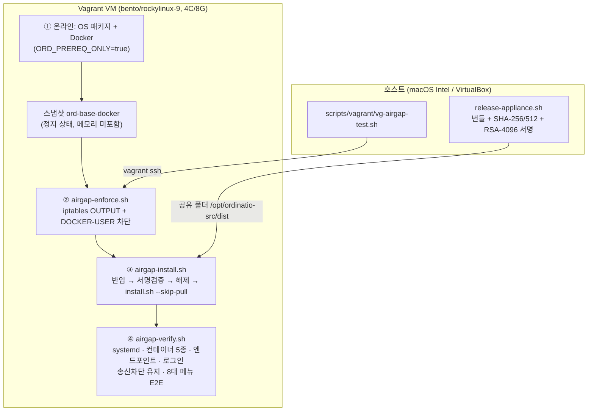

# PRE_51 폐쇄망 Standalone 설치 테스트베드 구축 및 결함 해결 보고서

**작성 일자**: 2026-11-28
**대상**: `ordinatio/deploy/standalone/`, `ordinatio/scripts/package-offline-bundle.sh`, `ordinatio/scripts/vagrant/`, `ordinatio/deploy/vagrant/`, `ordinatio/backend/app/core/semantic_cache.py`, `ordinatio/scripts/verify-standalone-install.sh`
**검증 상태**: 백엔드 **132 / 132 PASS**, Standalone **7 / 7 PASS** — 폐쇄망 VM 실설치(`make vg-airgap`)는 **미실행** (호스트 Docker 데몬 미기동, §6 참조)

---

## 1. 배경

외부망이 차단된 고객 서버에 **Docker 이미지를 직접 반입하여 `install.sh`(systemd 경로)로 설치**하는 시나리오를 재현할 가상 테스트 환경을 조사했다. 기존 검증 자산의 한계는 다음과 같았다.

| 기존 자산 | 한계 |
| :--- | :--- |
| `deploy/vagrant/` (Vagrantfile, provision.sh) | 인터넷에서 Docker 설치 + `install.sh --build` 소스 빌드 → 폐쇄망 검증 아님 |
| `scripts/multipass/mp-clean-install-test.sh` | Multipass 필요, Docker Hub에서 이미지 pull |
| PRE_41/43/44 | `make up`(compose 퀵스타트) 경로만 검증, `install.sh` + systemd 경로 미검증 |
| PRE_27 `mp-airgap.sh` (타입 C) | 계획만 존재, 파일 미구현 |

호스트(Intel x86_64 macOS, 32GB RAM, VirtualBox 7.2 + Vagrant 2.4.9, bento 박스 5종 보유, Multipass 미설치) 조건상 **Vagrant + VirtualBox**를 테스트베드로 채택했다.

---

## 2. 발견 및 해결 결함

| ID | 결함 | 영향 | 해결 |
| :--- | :--- | :--- | :--- |
| **D-1** | `install.sh`는 `ordinatio-standalone-images.tar.gz`를 찾지만 이를 생성하는 스크립트가 없음. 번들은 `bundle/images.tar.gz`를 생성 | 폐쇄망에서 `install.sh`가 외부 pull 시도 후 실패 | `install.sh`: `--images-tar` → `bundle/images.tar.gz` → 레거시 파일명 순 탐색 |
| **D-2** | 번들 이미지 태그 `ordinatio-*:prod` ≠ `install.sh` 기대 태그 `keikun808/ordinatio-*:<ver>` | 이미지를 로드해도 compose가 외부 pull 시도 | 번들러가 `config.py` `VERSION` 기준 릴리스 태그 추가 부여·저장, `install.sh`가 로드 후 5종 태그 전수 확인(누락 시 즉시 실패) |
| **D-3** | 번들에 `install.sh`·`ordinatio-ctl`·`.env.template`·standalone compose 등 설치 자산 미포함 | 번들만으로 systemd 설치 불가 | `package-offline-bundle.sh`가 `deploy/standalone/` 설치 자산 8종 + `deploy/frontend/default.conf` 포함 |
| **D-4** | 이미지 기본 버전 3중 불일치 (compose 0.1.4 / install.conf 0.1.5 / install.sh 0.1.6) | 설치 경로별 다른 이미지 참조 | 전부 `0.1.6`(`backend/app/core/config.py` 기준)으로 일치, `.env.template` `VERSION` 동기화 |
| **D-5** | backend 컨테이너 DNS가 `${DNS_SERVER:-10.10.0.2}` + 고정 `8.8.8.8`, 설치 기본값 `8.8.8.8` | 에어갭 원칙 위배(외부 공용 DNS 질의), 검증 Test 2 상시 FAIL | 이미지 직접 반입 설치에는 외부 DNS 불필요 → compose `dns:` 제거, `DNS_SERVER` 기본값 공란(호스트 리졸버 상속). 사내 DNS 지정 시에만 IPv4 검증 후 backend에 `dns:` 주입 (콤마 복수 지정) |
| **D-6** | **시맨틱 캐시 교차 응답**: 대화 전체를 단일 벡터로 임베딩하여, 주입된 GLOBAL 컴플라이언스 시스템 프롬프트가 벡터를 지배 | 서로 무관한 질문("Failover test prompt" vs "Canary fail trigger")이 유사도 **0.939**(임계 0.92)로 HIT → **동일 시스템 프롬프트를 쓰는 사용자 간 타 질문 응답 반환**. 테스트에서는 canary 요청이 캐시로 응답되어 auto-rollback 미발동(`test_canary_auto_rollback_on_consecutive_errors` 전체 스위트 실행 시 상시 FAIL) | 맥락(시스템 + 이전 턴)은 SHA-256 해시로 **정확 일치**를 키 프리픽스에 포함, 유사도는 **마지막 메시지에만** 적용. 회귀 테스트 2건 추가 |
| **D-7** | `verify-standalone-install.sh` Test 7이 `set -e` 하 명령 치환 실패로 무출력 종료, `"passed"` 문자열만으로 판정 | `1 failed, 129 passed`도 PASS로 오판 가능, 실패 시 원인 미출력 | pytest 종료 코드로 판정, 실패 시 `FAILED` 목록·요약 출력 |

> D-6 키 형식 변경으로 기존 Redis 캐시 항목은 조회되지 않으며 TTL(3600s) 경과 시 자연 소멸한다. 별도 이관 불필요.

---

## 3. 폐쇄망 설치 테스트베드 (`make vg-airgap`)



### 3.1 외부 송신 차단 방식
- 기본 라우트(NAT) 인터페이스로의 신규 송신을 `iptables OUTPUT`에서 DROP. 호스트(10.0.2.2) 방향과 ESTABLISHED 응답만 허용하여 `vagrant ssh`를 유지한다.
- 컨테이너 송신(FORWARD)은 Docker 재기동 시에도 보존되는 `DOCKER-USER` 체인에서 DROP.
- VirtualBox 공유 폴더는 네트워크가 아닌 게스트 채널이므로 반입 매체 역할을 유지한다.
- 차단 검증: 공인 IP(1.1.1.1:443), Docker Hub 레지스트리, 실제 DNS 질의(8.8.8.8:53 응답 수신 여부), 컨테이너 → 1.1.1.1.

### 3.2 사용법
```bash
make vg-airgap ARGS="--build-release --reboot-test"   # 번들 빌드·서명 → 폐쇄망 설치 → 재부팅 검증
make vg-airgap ARGS="--restore"                       # 기존 번들로 재검증 후 베이스 스냅샷 복원
make vg-airgap ARGS="--distro bento/ubuntu-24.04 --recreate"
make vg-clean
```
증적 로그: `ordinatio/logs/vagrant-airgap/<타임스탬프>-v<ver>-<box>.log`

---

## 4. 검증 결과

```bash
cd ordinatio && bash scripts/verify-standalone-install.sh
```
| 항목 | 결과 |
| :--- | :--- |
| Test 1~6 (PREREQUISITES, compose(외부 DNS 미사용), .env.template, install.sh CLI, ordinatio-ctl, Vagrant) | **6 / 6 PASS** |
| Test 7 백엔드 pytest 전체 | **132 passed** (exit 0) |
| 종합 | **🎉 DoD 7 / 7 PASS** |

| 추가 검증 | 결과 |
| :--- | :--- |
| `tests/test_semantic_cache.py` (회귀 2건 포함) | 6 / 6 PASS |
| `test_gateway_failover_chain_execution` → `test_canary_auto_rollback_on_consecutive_errors` 연속 실행 | 2 / 2 PASS (수정 전 1 FAIL 재현) |
| DNS 주입 로직 단위 실행 (`"10.10.0.2, 10.10.0.3"`) | backend `dns: [10.10.0.2, 10.10.0.3]`, YAML 파싱 정상 |
| 신규 셸 스크립트 4종 `bash -n` | PASS |

---

## 5. ADR

- **ADR-21 (폐쇄망 테스트베드)**: Intel 호스트에서는 기보유 VirtualBox/Vagrant 박스를 사용하고, 외부망 차단은 NAT 케이블 분리가 아닌 게스트 내부 iptables(OUTPUT + DOCKER-USER)로 수행한다. NAT 분리는 `vagrant ssh` 제어 채널까지 끊기 때문이다. Apple Silicon/WSL2 호스트는 PRE_27의 Multipass 경로를 유지한다.
- **ADR-22 (컨테이너 DNS)**: 오프라인 번들 직접 반입 설치에서는 외부 DNS를 사용하지 않는다. 기본값은 호스트 리졸버 상속이며, 사내 LLM 엔드포인트 호스트명 해석이 필요한 경우에만 사내 DNS를 명시 주입한다.
- **ADR-23 (시맨틱 캐시 키)**: 맥락은 정확 일치, 질의만 유사도 비교. 공통 시스템 프롬프트에 의한 교차 응답을 원천 차단한다.

---

## 6. 미수행 및 후속 과제

| 과제 | 상태 | 비고 |
| :--- | :--- | :--- |
| `make vg-airgap` 폐쇄망 VM 실설치 실측 | **미실행** | 호스트 Docker 데몬 미기동으로 번들 빌드 불가. Docker Desktop 기동 후 `make vg-airgap ARGS="--build-release --reboot-test"` 실행 및 본 문서 §4에 증적 추가 필요 (PRE_13 GAP-16) |
| `verify-offline-bundle.sh` | 미실행 | 동일 사유 |
| VirtualBox `<inaccessible>` 고아 VM 3건 | 미정리 | 호스트 디스크 여유 32GB, 정리 권장 |
| 개발용 `ordinatio/docker-compose.yml` `${DNS_SERVER:-8.8.8.8}` | 유지 | 서버 설치 경로가 아니므로 이번 범위 제외 |
