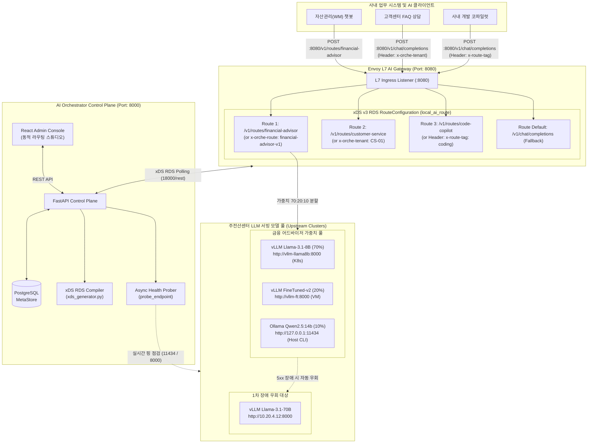

# [설계 문서] 모델 카탈로그 서빙 풀 및 Envoy L7 게이트웨이 동적 라우팅 설계서
(Model Catalog Serving Pool & Envoy L7 Gateway Dynamic Routing Architecture Specification)

## 1. 시스템 아키텍처 개요 (Architecture Overview)

본 문서는 **Enterprise AI Orchestrator Appliance**의 핵심 제어 평면인 **"모델 카탈로그 & 동적 라우팅 스튜디오"**의 아키텍처 및 상세 엔지니어링 규격을 정의합니다.

AI Orchestrator는 폐쇄망(Air-Gapped) 인프라에 100% 설치되어 운영되는 온프레미스 거버넌스 어플라이언스로서, 사내 전산망에 분산 배포된 다양한 LLM 서빙 런타임(vLLM, Ollama, SGLang, Triton 등)을 중앙 카탈로그로 통합 관리하고, Envoy L7 AI Gateway를 통해 트래픽 분할, 카나리 배포, 장애 우회, 및 업무 도메인별 엔드포인트를 무중단 xDS(RDS v3) 프로토콜로 동적 제어합니다.



---

## 2. 모델 카탈로그 및 런타임 엔진 규격 (Model Catalog Specification)

### 2.1 서빙 엔진 및 실행 방식 모델링
사내 인프라의 다양한 가속기(GPU/NPU) 및 배포 형태를 포용하기 위해 `ModelCatalog` 엔티티는 다음과 같은 확장 속성을 유지합니다.

| 필드명 | 타입 | 기본값 | 지원 옵션 및 설명 |
| :--- | :---: | :---: | :--- |
| `model_id` | `VARCHAR(128)` | - | 모델 고유 식별자 (예: `meta-llama/Llama-3.1-8B-Instruct`, `qwen2.5:14b`) |
| `alias` | `VARCHAR(64)` | - | Envoy 클러스터 매핑용 고유 별칭 (예: `financial-advisor-v1`) |
| `serving_engine` | `VARCHAR(32)` | `vLLM` | **서빙 런타임 엔진**: `vLLM` (고처리량/연속배치), `Ollama` (경량 GGUF), `SGLang` (구조화 생성), `Triton` (멀티 백엔드) |
| `execution_method`| `VARCHAR(32)` | `k8s` | **실행/배포 환경**: `k8s` (온프레미스 파드), `docker-compose` (컨테이너/VM), `direct` (서버 호스트 OS 직접 CLI 구동) |
| `backend_infra` | `VARCHAR(64)` | `On-Prem K8s` | 인프라 명칭 (예: `On-Prem K8s`, `Bare-Metal GPU`, `Local Server`) |
| `target_endpoint`| `VARCHAR(256)` | - | 실제 기동된 LLM 인스턴스의 Upstream 원본 URL (예: `http://127.0.0.1:11434`, `http://vllm-llama8b.ai-serving:8000`) |
| `input_price_per_1k`| `NUMERIC(10,4)`| `0.8000` | 1,000 프롬프트 토큰당 원화 단가 (₩) |
| `output_price_per_1k`| `NUMERIC(10,4)`| `2.4000` | 1,000 완료 토큰당 원화 단가 (₩) |
| `is_active` | `BOOLEAN` | `TRUE` | 서빙 등록 및 라우팅 풀 포함 활성화 여부 |

### 2.2 운영자 구동 스크립트 가이드 템플릿 (Launch Snippet Box)
AI Orchestrator는 이미 기동된 엔드포인트를 등록받아 L7 거버넌스를 수행하므로, 관리자가 호스트 서버에서 LLM을 구동할 때 참고할 수 있도록 실행 환경별 표준 템플릿을 UI에 제공합니다.
- **Ollama (Direct Host)**: `OLLAMA_HOST=0.0.0.0:11434 ollama serve && ollama run {model_id}`
- **Ollama (Docker)**: `docker run -d --gpus=all -v ollama:/root/.ollama -p 11434:11434 --name ollama ollama/ollama`
- **vLLM (Direct Host)**: `python3 -m vllm.entrypoints.openai.api_server --model {model_id} --port 8000 --max-model-len 8192`
- **vLLM (Docker)**: `docker run --gpus all -p 8000:8000 --ipc=host vllm/vllm-openai:latest --model {model_id}`

---

## 3. 실시간 헬스체크 프로빙 아키텍처 (Health Probing Engine)

### 3.1 비동기 프로빙 파이프라인 (`probe_endpoint`)
백엔드 제어 평면은 등록된 모델 풀의 생존 상태와 네트워크 레이턴시를 비동기로 측정합니다.
- **타임아웃**: 2.5초 (빠른 실패 보장 및 UI 블로킹 방지)
- **엔진별 프로빙 경로 자동 분기**:
  - `Ollama`: `GET /api/tags` (우선), `GET /` (대체)
  - `vLLM` / `SGLang`: `GET /health` (우선), `GET /v1/models` (대체)
  - `Triton`: `GET /v1/health/ready` (우선), `GET /` (대체)
- **도커 및 에어갭 루프백 페일오버**:
  - 엔드포인트가 `127.0.0.1` 또는 `localhost`인 경우, 컨테이너 격리 환경을 고려하여 호스트 루프백(`host.docker.internal`)을 자동 폴백 시도하여 실제 호스트 상의 Ollama 인스턴스를 정상 인식.
- **정밀 레이턴시 측정**: `time.perf_counter()` 기반 마이크로초 정밀도 계산 후 ms 단위 반환.

### 3.2 헬스체크 API 엔드포인트 규격
1. **전체 모델 동시 헬스체크**: `GET /api/v1/models/health-check`
   - `asyncio.gather`를 통해 전체 등록 모델을 병렬 프로빙
   - 응답: `List[ModelHealthCheckResult]`
     ```json
     [
       {
         "model_id": "qwen2.5:14b",
         "alias": "ollama-local-advisor",
         "serving_engine": "Ollama",
         "execution_method": "direct",
         "target_endpoint": "http://127.0.0.1:11434",
         "is_healthy": true,
         "status_code": 200,
         "latency_ms": 14.5,
         "error_message": null,
         "checked_at": "2026-09-13T00:00:00Z"
       }
     ]
     ```
2. **단일 모델 즉시 헬스체크**: `POST /api/v1/models/{model_id:path}/health`
   - 특정 모델의 엔드포인트를 즉각 점검하여 최신 상태 반환.

---

## 4. Envoy L7 게이트웨이 동적 라우팅 규격 (Gateway Routing Specification)

### 4.1 이원화된 엔드포인트 연동 방식 (Dual Ingress Access Modes)
클라이언트는 Envoy L7 게이트웨이(기본 포트: `8080`)를 통해 라우트에 접근하며, 두 가지 표준 방식을 지원합니다:

#### [방식 1] 경로 기반 전용 가상 엔드포인트 (Path-based Routing)
- **엔드포인트**: `POST http://<ENVOY_HOST>:8080/v1/routes/{route_name}`
- **동작 원리**:
  - Envoy Route 매칭: `match: { prefix: "/v1/routes/{route_name}" }`
  - 접두사 재작성: `route: { prefix_rewrite: "/v1/chat/completions", weighted_clusters: ... }`
- **장점**: 클라이언트가 별도 커스텀 헤더를 지정할 필요 없이, OpenAI 공식 SDK의 `base_url` 파라미터에 URL을 그대로 지정하여 투명하게 연동 가능.

#### [방식 2] 표준 OpenAI 공통 엔드포인트 + 라우트/테넌트 헤더 (Header-based Routing)
- **엔드포인트**: `POST http://<ENVOY_HOST>:8080/v1/chat/completions`
- **헤더 규격**:
  - `x-orche-route: {route_name}`: 목적지 가상 라우트 직접 지정
  - `x-orche-tenant: {tenant_code}`: 호출자의 부서/테넌트 코드(예: `WM-01`)에 매핑된 라우트로 자동 분기
  - `x-route-tag: {tag}`: 업무 태그(예: `coding`) 기반 분기
- **장점**: 모든 클라이언트가 단일 엔드포인트를 유지하면서 헤더만으로 유연하게 라우팅 분기.

### 4.2 Envoy xDS RouteConfiguration 컴파일 규격 (`app/core/xds_generator.py`)
`generate_envoy_multi_route_configuration` 함수는 등록된 복수의 `RoutingPolicy`를 다음 순서로 컴파일합니다:
1. **시스템 엔드포인트 우선 보호**: `/health`, `/api` -> `backend_service`
2. **우선순위(Priority) 정렬**: `priority` 오름차순 (1이 10보다 우선 평가)
3. **특정 조건 매처 등록**:
   - `path_prefix` (접두사 재작성 포함)
   - `x-orche-route` 헤더 매처
   - `x-orche-tenant` 헤더 매처
   - 사용자 정의 커스텀 헤더 매처
4. **기본 폴백 라우트 등록**: 헤더가 없는 일반 `/v1/chat/completions` 호출을 최우선 기본 라우트로 디스패치.

### 4.3 게이트웨이 실시간 테스트 호출 (`POST /api/v1/routing/test-call`)
운영자가 브라우저 콘솔에서 즉시 Envoy 게이트웨이의 정상 작동 여부를 검증할 수 있도록 백엔드 프록시 테스트 엔드포인트를 제공합니다.
- **요청 Body**: `{"route_name": "financial-advisor-v1", "method": "path" | "header", "message": "..."}`
- **동작**: 백엔드가 Envoy 게이트웨이(포트 8080)로 실제 HTTP POST 요청을 전송하고 지연시간, HTTP 응답 상태 코드, 디스패치 결과를 반환.

---

## 5. 관리자 웹 콘솔 UI 규격 (`RoutingTab.jsx`)

### 5.1 라우트 선택 바 (Route Selector Bar)
- 등록된 모든 가상 라우트 프로필 버튼에 고유 경로 접두사 배지(예: `/v1/routes/financial-advisor`)와 우선순위 배지를 함께 표출.
- 상단에 Envoy L7 게이트웨이 기본 포트(`port 8080`) 및 현재 활성화된 xDS 리비전(`xds-rev-...`)을 명시.

### 5.2 Envoy 게이트웨이 API 엔드포인트 연동 패널 (신설)
각 라우트 선택 시 상단에 전용 연동 패널을 노출합니다:
1. **메인 엔드포인트 URL 박스**:
   - `POST http://localhost:8080/v1/routes/{route_name}`
   - 초록색 `POST` 배지 및 **[URL 복사]** 버튼 (복사 시 2초간 '복사됨!' 피드백 제공).
2. **3개 연동 가이드 탭**:
   - **탭 1: 경로 기반 호출**: cURL 예제 스니펫 및 원클릭 복사
   - **탭 2: 공통 엔드포인트 + 라우트 헤더**: cURL 예제 스니펫 및 헤더 복사
   - **탭 3: Python (OpenAI SDK)**: `OpenAI(base_url="...", api_key="sk-orch-...")` 파이썬 예제 코드
3. **⚡ 게이트웨이 즉시 테스트 호출 버튼**:
   - 클릭 시 Envoy 게이트웨이에 샘플 요청을 전송하고 응답 지연시간(ms) 및 결과를 즉각 패널 내에 표시.

### 5.3 모델 풀 테이블 상태 및 업스트림 안내 배너
- **업스트림 안내 배너**:
  `💡 안내: 아래 모델 목록의 엔드포인트는 주전산센터 내부 'Upstream 원본 서버' 주소입니다. 외부 클라이언트는 상단의 'Envoy L7 게이트웨이 엔드포인트(포트 8080)'로 인입되어 가중치 분산 처리됩니다.`
- **전체 헬스체크 (Ping All) 버튼**:
  - 테이블 상단 헤더에 실시간 점검 버튼 배치.
- **상태 & 헬스 컬럼**:
  - 관리 상태 배지: `정상 서빙` / `비활성`
  - 실시간 생존 뱃지:
    - 🟢 `● 정상 (14.5ms)` + 재점검 아이콘
    - 🔴 `✕ 오프라인 (사유 툴팁)` + 재시도 아이콘
    - ⚡ `핑 테스트` 버튼 (미점검 시)

---

## 6. 테스트 및 검증 매트릭스 (Verification Matrix)

| 검증 항목 | 검증 방식 | 대상 모듈 | 합격 기준 | 상태 |
| :--- | :---: | :--- | :--- | :---: |
| 모델 카탈로그 확장 | pytest | `test_routing.py::test_model_catalog_crud` | serving_engine, execution_method 저장/조회 | **PASS** |
| 서빙 모델 헬스체크 | pytest | `test_routing.py::test_model_serving_health_check` | 전체/단일 헬스체크 및 404 예외 처리 | **PASS** |
| xDS 경로 재작성 컴파일 | pytest | `test_routing.py::test_multi_route_crud_and_xds_compilation` | prefix_rewrite="/v1/chat/completions" 확인 | **PASS** |
| xDS 헤더 매칭 컴파일 | pytest | `test_routing.py::test_multi_route_crud_and_xds_compilation` | x-orche-route 헤더 매처 존재 확인 | **PASS** |
| 게이트웨이 테스트 프록시 | pytest | `test_routing.py::test_route_test_call_endpoint` | 경로/헤더 방식 호출 및 결과 반환 확인 | **PASS** |
| Ollama 실환경 핑 | curl | `GET /api/v1/models/health-check` | 호스트 Ollama 200 OK (152ms) 확인 | **PASS** |
| Envoy 포트 8080 디스패치 | curl | `POST /api/v1/routing/test-call` | Envoy(8080) 경유 업스트림 연결 확인 | **PASS** |
| 게이트웨이 엔드포인트 실시간 테스트 호출 | pytest | `tests/test_routing.py::test_route_test_call_endpoint` | 경로/헤더 방식 Envoy 엔드포인트 연동 검증 | **PASS** |
| OpenAI 호환 L7 게이트웨이 인그레스 E2E | pytest | `tests/test_routing.py::test_gateway_openai_chat_completions_ingress` | `/v1/routes`, `/v1/chat/completions`, PII 차단, 가상키 인증 | **PASS** |
| 프론트엔드 빌드 무결성 | vite build | `npm run build` | 프로덕션 번들링 0건 에러 (3.28s) | **PASS** |
| 전체 백엔드 회귀 테스트 | pytest | `aiorche/backend/` | 46 / 46 테스트 100% 통과 | **PASS** |
