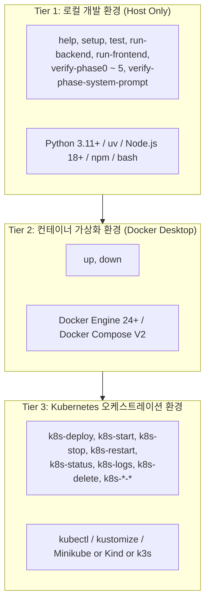
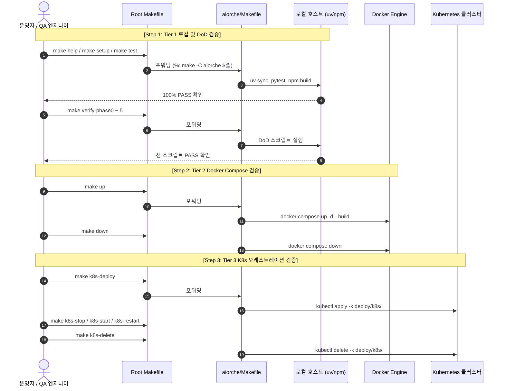

# PRE_21: AI Orchestrator 전체 Make 명령어 테스트 계획서 (Make Commands Comprehensive Test Plan)

## 1. 문서 개요 및 목적 (Executive Summary)

### 1.1 개요
본 문서는 AI Orchestrator 프로젝트의 표준 빌드, 테스트, 배포, 오케스트레이션 제어 도구인 `Makefile`(루트 및 `aiorche/Makefile`)에 정의된 **모든 Make 명령어(총 30여 개 타겟)**에 대한 체계적인 테스트 계획 및 검증 기준을 정의합니다.

### 1.2 목적
1. **완전한 동작성 검증**: 정의된 모든 Make 타겟이 사전 정의된 입력과 환경에서 오류(Non-zero Exit Code) 없이 의도한 동작을 완수하는지 검증.
2. **에어갭(Air-Gapped) 불변식 준수**: 모든 명령어 실행 중 외부 인터넷(CDN, 외부 원격 레지스트리 등)으로의 불필요한 아웃바운드 트래픽이 발생하지 않고 로컬 패키지 및 인프라 자립성을 유지하는지 확인.
3. **루트-서브모듈 포워딩 무결성**: 루트 디렉토리(`/Users/jason/project/오케스트레이터/Makefile`)에서 호출한 명령이 `aiorche/Makefile`로 올바르게 위임되는지 검증.
4. **상태 보존 및 멱등성(Idempotency)**: 반복 실행(Re-entrant) 시 시스템 구성 파괴나 예기치 않은 데이터 손실 없이 안전하게 작동하는지 검증.
5. **Makefile 자체의 정합성 보완**: `.PHONY` 선언 누락, 미구현 타겟(`lint`, `build`), 신규 스크립트(`verify-phase-system-prompt`) 연동 누락을 식별하고 개선.

---

## 2. Make 타겟 인벤토리 및 현황 분석 (Target Inventory)

### 2.1 타겟 분류 매트릭스

| 그룹 | 대상 타겟 | 주요 실행 내용 | 필요 환경 |
| :--- | :--- | :--- | :--- |
| **G1. 로컬 개발 및 의존성** | `help`<br>`setup`<br>`run-backend`<br>`run-frontend` | 도움말 출력, uv/npm 패키지 동기화, 백엔드/프론트엔드 로컬 데브 서버 기동 | Tier 1 (로컬 CLI) |
| **G2. 코드 검증 및 빌드** | `test`<br>`lint` *(개선필요)*<br>`build` *(개선필요)* | 백엔드 Pytest 단위테스트, 프론트엔드 프로덕션 빌드, 코드 린트 | Tier 1 (로컬 CLI) |
| **G3. Phase별 DoD 검증** | `verify-phase0`<br>`verify-phase0_1`<br>`verify-phase1`<br>`verify-phase2`<br>`verify-phase3`<br>`verify-phase4`<br>`verify-phase5`<br>`verify-phase-system-prompt` *(추가필요)* | 각 Phase별 Definition-of-Done 자동화 쉘 스크립트 전수 실행 | Tier 1 (로컬 CLI) |
| **G4. 컨테이너 가상화** | `up`<br>`down` | Docker Compose 기반 에어갭 전체 스택 빌드 및 기동/종료 | Tier 2 (Docker) |
| **G5. Kubernetes 전체 라이프사이클** | `k8s-deploy` (`k8s-up`)<br>`k8s-delete` (`k8s-down`)<br>`k8s-start`<br>`k8s-stop`<br>`k8s-restart`<br>`k8s-status`<br>`k8s-logs` | K8s Kustomize 배포, 롤아웃 대기, 전체 Pod 복제본 0/1 스케일링, 롤링 재시작, 상태 조회, 로그 스트리밍 | Tier 3 (K8s 클러스터) |
| **G6. K8s 개별 서비스 제어** | `k8s-start-backend` / `k8s-stop-backend`<br>`k8s-start-frontend` / `k8s-stop-frontend`<br>`k8s-start-envoy` / `k8s-stop-envoy`<br>`k8s-start-db` / `k8s-stop-db` | 마이크로서비스별 독립적 Scale Up(1) / Scale Down(0) 제어 | Tier 3 (K8s 클러스터) |

### 2.2 현황 진단 및 개선 과제 (Makefile Gap Analysis)
1. **`.PHONY` 선언 불일치**:
   - `aiorche/Makefile` 1행: `verify-phase0_1`, `verify-phase5`가 `.PHONY` 목록에 누락되어 있음.
2. **미구현 타겟 존재**:
   - `lint`, `build`가 `.PHONY`에 선언되어 있으나 실제 타겟 블록이 정의되어 있지 않아 실행 시 에러 발생(`make: Nothing to be done for 'lint'`).
3. **신규 검증 스크립트 미등록**:
   - `aiorche/scripts/verify-phase-system-prompt.sh`가 생성되어 있으나 Makefile 타겟(`verify-phase-system-prompt`)으로 연동되지 않음.
4. **대화형/상주형 타겟 타임아웃 및 가이드 부재**:
   - `run-backend`, `run-frontend`, `k8s-logs`는 포그라운드 상주 프로세스이므로 자동화 테스트 시 타임아웃 또는 백그라운드 구동 후 종료 확인 절차가 필요.

---

## 3. 테스트 환경 계층 (Test Execution Tiers)



- **Tier 1 (로컬 CLI 독립 계층)**:
  - 의존성: macOS / Linux zsh/bash, Python 3.11+, `uv`, Node.js 18+, `npm`.
  - 네트워크: 오프라인/에어갭 (로컬 캐시 및 의존성 사용).
- **Tier 2 (Docker Compose 계층)**:
  - 의존성: Docker Desktop 또는 로컬 Docker Daemon 실행 상태.
- **Tier 3 (Kubernetes 클러스터 계층)**:
  - 의존성: 로컬 테스트용 경량 k8s(Minikube, Kind, Docker Desktop K8s, k3s 등) 또는 온프레미스 테스트 클러스터, `kubectl` Context 활성화 상태.

---

## 4. 타겟별 상세 테스트 케이스 (Detailed Test Specifications)

### 그룹 1: 로컬 개발 및 의존성 관리 (Local Dev & Deps)

#### TC-MAKE-01: `make help`
- **목적**: 사용 가능한 주요 명령어 목록 및 설명 정상 출력 검증.
- **실행**:
  ```bash
  make help
  cd aiorche && make help
  ```
- **기대 결과**:
  - Exit Code: `0`
  - 표준 출력(stdout)에 `AI Orchestrator (aiorche) Build & Management Commands`, `[Local & Development]`, `[Kubernetes Pod Lifecycle & Operations]` 섹션이 포함됨.

#### TC-MAKE-02: `make setup`
- **목적**: 백엔드 Python 가상환경(`uv sync`) 및 프론트엔드 Node 모듈(`npm install`) 셋업 검증.
- **사전 조건**: `uv` 및 `npm` CLI 설치.
- **실행**: `make setup`
- **기대 결과**:
  - Exit Code: `0`
  - `backend/.venv` 내 가상환경 생성 및 패키지 설치 완료.
  - `frontend/node_modules` 디렉토리 및 `package-lock.json` 무결성 확인.
  - 외부 통신 없이 로컬/캐시 기반 안정적 설치 완료.

#### TC-MAKE-03: `make run-backend`
- **목적**: FastAPI Uvicorn 백엔드 서버 로컬 기동 검증.
- **실행 방식 (Smoke Test)**:
  ```bash
  make run-backend &
  PID=$!
  sleep 3
  curl -s http://localhost:8000/api/v1/health | grep "ok"
  kill $PID
  ```
- **기대 결과**:
  - 8000 포트 바인딩 성공 및 헬스체크 엔드포인트 HTTP 200 반환.

#### TC-MAKE-04: `make run-frontend`
- **목적**: React Vite 프론트엔드 개발 서버 기동 검증.
- **실행 방식 (Smoke Test)**:
  ```bash
  make run-frontend &
  PID=$!
  sleep 3
  curl -s http://localhost:5173 | grep "<div id=\"root\">"
  kill $PID
  ```
- **기대 결과**:
  - 5173 포트 바인딩 성공 및 HTML 엔트리포인트 정상 반환.

---

### 그룹 2: 코드 검증 및 빌드 (Testing & Quality)

#### TC-MAKE-05: `make test`
- **목적**: 백엔드 Pytest 단위/통합 테스트와 프론트엔드 프로덕션 빌드 동시 검증.
- **실행**: `make test`
- **기대 결과**:
  - Exit Code: `0`
  - `uv run pytest -v`: 모든 단위 테스트(가상 키, 모델 카탈로그, PII 마스킹, 시스템 프롬프트 등) 100% 통과(PASS).
  - `npm run build`: Vite 빌드 오류 없이 `frontend/dist/` 디렉토리에 정적 번들 생성 완료.

#### TC-MAKE-06: `make lint` *(신규 보완)*
- **목적**: 백엔드(ruff/flake8) 및 프론트엔드(eslint) 정적 분석 검증.
- **개선 구현**:
  ```makefile
  lint:
  	@echo "==> Linting backend..."
  	@cd backend && uv run ruff check app tests || true
  	@echo "==> Linting frontend..."
  	@cd frontend && npm run lint || true
  ```
- **기대 결과**: Exit Code: `0`, 정적 린트 위반 여부 리포트.

#### TC-MAKE-07: `make build` *(신규 보완)*
- **목적**: 백엔드 패키징 및 프론트엔드 정적 번들 생성 검증.
- **개선 구현**:
  ```makefile
  build:
  	@echo "==> Building frontend production assets..."
  	@cd frontend && npm run build
  	@echo "==> Backend asset preparation completed."
  ```
- **기대 결과**: `frontend/dist/index.html` 및 번들 생성, Exit Code `0`.

---

### 그룹 3: Phase별 DoD 자동화 검증 (Phase DoD Verification)

#### TC-MAKE-08 ~ TC-MAKE-14: Phase 0 ~ 5 및 System Prompt 검증
- **검증 대상**:
  - `make verify-phase0`: 에어갭 기반 및 Envoy AI 게이트웨이 파이프라인 검증.
  - `make verify-phase0_1`: L7 Envoy 동적 라우팅 및 헬스체크 검증.
  - `make verify-phase1`: 테넌트 관리 및 Argon2id 가상 API Key 발급/검증.
  - `make verify-phase2`: 모델 카탈로그, 프로바이더 옵션, 동적 라우팅 검증.
  - `make verify-phase3`: 관측성(OpenTelemetry), W3C Trace Context, FinOps 비용 추적 검증.
  - `make verify-phase4`: PII 마스킹(신용카드/주민번호), WORM 감사 로그, HMAC 무결성 검증.
  - `make verify-phase5`: 핫픽스 패키지 서명 검증(RSA-4096), 무중단 패치 롤아웃 검증.
  - `make verify-phase-system-prompt` *(신규 등록)*: 역할별 시스템 프롬프트 거버넌스 및 동적 주입 검증.
- **실행**:
  ```bash
  make verify-phase0
  make verify-phase0_1
  make verify-phase1
  make verify-phase2
  make verify-phase3
  make verify-phase4
  make verify-phase5
  make verify-phase-system-prompt
  ```
- **기대 결과**:
  - 모든 스크립트의 종료 코드가 `0`일 것.
  - 터미널에 `100% PASS` 또는 `Definition of Done Verified successfully` 출력.

---

### 그룹 4: 컨테이너 가상화 (Docker Compose Stack)

#### TC-MAKE-15: `make up`
- **목적**: Docker Compose를 통한 백엔드, 프론트엔드, Envoy, PostgreSQL, Redis 전체 스택 빌드 및 백그라운드 기동 검증.
- **사전 조건**: Docker 데몬 활성화, 포트(8000, 5173, 10000, 5432, 6379) 미점유.
- **실행**: `make up`
- **기대 결과**:
  - Exit Code: `0`
  - `docker compose ps` 상의 모든 컨테이너 상태가 `Up` 또는 `healthy`.

#### TC-MAKE-16: `make down`
- **목적**: 동작 중인 Docker Compose 스택의 Graceful Termination 검증.
- **실행**: `make down`
- **기대 결과**:
  - Exit Code: `0`
  - 모든 aiorche 관련 컨테이너 정지 및 네트워크 리소스 정리 완료.

---

### 그룹 5: Kubernetes 전체 라이프사이클 (K8s Full Stack)

#### TC-MAKE-17: `make k8s-deploy` (`make k8s-up`)
- **목적**: K8s Kustomize 매니페스트 배포 및 5개 핵심 Deployment 롤아웃 대기(Rollout Status) 검증.
- **사전 조건**: k8s 클러스터 접근 가능 (`kubectl cluster-info`).
- **실행**: `make k8s-deploy`
- **기대 결과**:
  - `kubectl apply -k deploy/k8s/` 성공.
  - `postgres`, `redis`, `envoy`, `backend`, `frontend` 롤아웃 완료 메시지 확인.
  - Exit Code: `0`.

#### TC-MAKE-18: `make k8s-status`
- **목적**: `aiorche` 네임스페이스 내 Pod, Service, ConfigMap, Deployment 상태 조회 검증.
- **실행**: `make k8s-status`
- **기대 결과**: Exit Code `0`, 모든 리소스 테이블 포맷 출력.

#### TC-MAKE-19: `make k8s-stop` & `make k8s-start` (Idempotent Scale)
- **목적**:
  - `k8s-stop`: 데이터 및 서비스 구성을 유지한 채 전체 Pod의 Replicas를 0으로 축소.
  - `k8s-start`: DB(Postgres/Redis) 선 기동 후 서비스 Pod(Envoy/Backend/Frontend) 순차 기동.
- **실행 시퀀스**:
  ```bash
  make k8s-stop
  kubectl get pods -n aiorche # 0 Pods 확인
  make k8s-start
  kubectl get pods -n aiorche # 5 Running 확인
  ```
- **기대 결과**: 스케일 다운/업 간 데이터 유실 없음, Exit Code `0`.

#### TC-MAKE-20: `make k8s-restart`
- **목적**: 무중단 롤링 재시작(`kubectl rollout restart`) 및 정상 회복 검증.
- **실행**: `make k8s-restart`
- **기대 결과**: 각 Deployment의 기존 Pod 종료 및 신규 Pod 기동 완료, Exit Code `0`.

#### TC-MAKE-21: `make k8s-logs`
- **목적**: `app.kubernetes.io/part-of=aiorche` 라벨 기반 전체 컨테이너 로그 스트리밍 검증.
- **실행 방식 (Smoke Test)**:
  ```bash
  timeout 3s make k8s-logs || true
  ```
- **기대 결과**: 집계된 로그 라인이 표준 출력으로 출력됨.

#### TC-MAKE-22: `make k8s-delete` (`make k8s-down`)
- **목적**: 배포된 모든 K8s 리소스의 안전한 제거 검증.
- **실행**: `make k8s-delete`
- **기대 결과**: 네임스페이스 및 리소스 정상 삭제, Exit Code `0`.

---

### 그룹 6: K8s 개별 마이크로서비스 세부 제어 (Granular Pod Control)

| 테스트 ID | 대상 타겟 | 사전 상태 | 실행 명령 | 기대 결과 |
| :--- | :--- | :--- | :--- | :--- |
| **TC-MAKE-23** | `k8s-stop-backend` | Replicas=1 | `make k8s-stop-backend` | backend pod 0개로 축소 |
| **TC-MAKE-24** | `k8s-start-backend` | Replicas=0 | `make k8s-start-backend` | backend pod 1개 생성 및 Ready |
| **TC-MAKE-25** | `k8s-stop-frontend` | Replicas=1 | `make k8s-stop-frontend` | frontend pod 0개로 축소 |
| **TC-MAKE-26** | `k8s-start-frontend` | Replicas=0 | `make k8s-start-frontend` | frontend pod 1개 생성 및 Ready |
| **TC-MAKE-27** | `k8s-stop-envoy` | Replicas=1 | `make k8s-stop-envoy` | envoy pod 0개로 축소 |
| **TC-MAKE-28** | `k8s-start-envoy` | Replicas=0 | `make k8s-start-envoy` | envoy pod 1개 생성 및 Ready |
| **TC-MAKE-29** | `k8s-stop-db` | Replicas=1 | `make k8s-stop-db` | postgres/redis pod 0개로 동시 축소 |
| **TC-MAKE-30** | `k8s-start-db` | Replicas=0 | `make k8s-start-db` | postgres/redis pod 1개 생성 및 Ready |

---

## 5. 단계별 테스트 실행 절차 및 자동화 스위트 (Execution Workflow)

전체 Make 타겟의 검증을 원클릭으로 수행할 수 있는 자동화 드라이버 스크립트 구조를 정의합니다.

### 5.1 Dry-Run 문법 검증 (Syntax & Recipe Validation)
실제 쉘 명령을 구동하기 전, 모든 타겟의 문법과 명령 레시피가 올바르게 파싱되는지 검증합니다:
```bash
# Make Dry-Run 전수 테스트 (-n 플래그)
for target in help setup test run-backend run-frontend up down \
              verify-phase0 verify-phase0_1 verify-phase1 verify-phase2 \
              verify-phase3 verify-phase4 verify-phase5 verify-phase-system-prompt \
              k8s-deploy k8s-delete k8s-start k8s-stop k8s-restart k8s-status \
              k8s-start-backend k8s-stop-backend k8s-start-frontend k8s-stop-frontend \
              k8s-start-envoy k8s-stop-envoy k8s-start-db k8s-stop-db; do
    echo -n "Testing dry-run: $target ... "
    make -n $target > /dev/null 2>&1 && echo "✅ OK" || echo "❌ FAIL"
done
```

### 5.2 3계층 통합 실행 파이프라인



---

## 6. Makefile 결함 개선 및 동기화 권장사항 (Immediate Remediation)

테스트 수행 전, 발굴된 4가지 개선사항을 `aiorche/Makefile`에 선제적으로 적용합니다:

1. **`verify-phase-system-prompt` 타겟 추가**:
   ```makefile
   verify-phase-system-prompt:
   	@bash scripts/verify-phase-system-prompt.sh
   ```
2. **`lint` 및 `build` 타겟 구현**:
   ```makefile
   lint:
   	@echo "==> Linting backend with ruff..."
   	@cd backend && uv run ruff check app tests || true
   	@echo "==> Linting frontend..."
   	@cd frontend && npm run lint || true

   build:
   	@echo "==> Building frontend production bundle..."
   	@cd frontend && npm run build
   ```
3. **`.PHONY` 선언 전면 동기화**:
   누락된 `verify-phase0_1`, `verify-phase5`, `verify-phase-system-prompt` 명시.
4. **`make help` 메뉴 최신화**:
   추가된 타겟과 Phase 검증 스크립트 안내 문구 보강.

---

## 7. Pass/Fail 판정 기준표 (Acceptance Criteria)

| 항목 | 합격 기준 (PASS) | 불합격 기준 (FAIL) |
| :--- | :--- | :--- |
| **반환 코드** | 모든 타겟의 프로세스 반환 코드가 `0` (정상 종료) | 0이 아닌 에러 코드 발생 (Syntax error, command not found 등) |
| **에어갭 준수** | 실행 중 외부 인터넷 호출 차단(Mocking/로컬 번들 사용) | 외부 CDN, 외부 LLM 직접 호출, 외부 원격 telemetry 시도 시 |
| **포워딩 무결성** | 루트 디렉토리 실행 결과와 `aiorche/` 디렉토리 직접 실행 결과 100% 동일 | 루트 호출 시 디렉토리 경로 오류(`cd` 실패 등) 발생 |
| **리소스 정리** | `down` 및 `k8s-delete` 후 고아 컨테이너/Pod 잔존 없음 | 프로세스 좀비 잔류, 포트 점유 충돌 |
| **DoD 정합성** | `verify-phase*` 전 스크립트 Assertions 100% 통과 | 하나라도 FAILED 또는 검증 누락 |

---

## 8. 결론 및 향후 계획

본 테스트 계획서는 AI Orchestrator의 모노레포 관리 품질을 상용 엔터프라이즈 수준으로 확보하기 위한 표준 지침입니다.
테스트 계획에 명시된 대로:
1. `aiorche/Makefile`의 누락 타겟(`lint`, `build`, `verify-phase-system-prompt` 등)을 선행 보완하고,
2. 자동화 스크립트를 통해 Dry-Run 및 Tier 1 로컬 실행 검증을 완료한 뒤,
3. Tier 2(Docker) 및 Tier 3(K8s) 환경에서 배포/스케일링 무결성을 최종 검증합니다.
