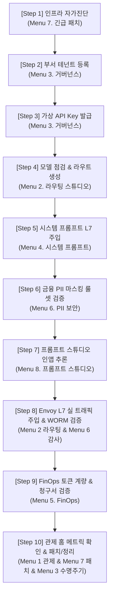

# [PRE-25] AI 오케스트레이터 전체 메뉴 활용 및 모니터링 통합 테스트 시나리오 & 계획서
## All-Menus Integrated Operational Test Scenario & Comprehensive Monitoring Specification

**문서 번호**: AIORCHE-DOC-PRE25-TEST-SCENARIO  
**작성 일자**: 2026-09-26  
**문서 버전**: v1.0 (Phase 0 ~ Phase 5 및 시스템 프롬프트 거버넌스 전면 통합)  
**대상 시스템**: AI Orchestrator Enterprise Appliance (100% Air-Gapped On-Premise)  
**관련 표준**: [`PRE_01_dashboard_engineering_plan.md`](./PRE_01_dashboard_engineering_plan.md), [`PRE_10_INTEGRATED_FUNCTIONAL_TEST_SPEC.md`](./PRE_10_INTEGRATED_FUNCTIONAL_TEST_SPEC.md), [`PRE_23_ui_taxonomy_and_element_specification.md`](./PRE_23_ui_taxonomy_and_element_specification.md)

---

## 1. 개요 및 테스트 목표 (Executive Summary & Objectives)

### 1.1 배경 및 목적
AI Orchestrator는 폐쇄망(Air-Gapped) 온프레미스 인프라에서 구동되는 고객 자율 운영형 어플라이언스입니다.  
본 문서는 관리자 웹 콘솔에 존재하는 **8대 핵심 메뉴(글로벌 관제 홈, 모델 & 라우팅 스튜디오, 거버넌스, 시스템 프롬프트 거버넌스, FinOps 비용 & 예산, PII 보안 & 감사 포렌식, 긴급 패치 & 자가진단, 프롬프트 스튜디오)**를 유기적으로 연결하여, 실제 금융·엔터프라이즈 업무 흐름에 맞춰 **모든 메뉴를 순차적으로 활용하고 그에 따른 인프라·보안·비용 텔레메트리를 실시간으로 종합 모니터링**하는 **통합 테스트 시나리오(End-to-End Integrated Scenario)**를 정의합니다.

### 1.2 5대 검증 불변 원칙 (5 Verification Invariants)
1. **100% 에어갭 자립성**: 외부 인터넷이나 외부 SaaS(CDN, 외부 텔레메트리, 외부 모델 API) 호출 없이 로컬 클러스터 내부에서 모든 시나리오가 완결되어야 함.
2. **전 메뉴 유기적 상호작용 (Cross-Menu Data Flow)**:
   - `Menu 3(거버넌스)`에서 생성된 부서와 가상키가 `Menu 2(라우팅)`의 테넌트 바인딩 및 `Menu 4(시스템 프롬프트)`의 주입 대상, `Menu 5(FinOps)`의 토큰 정산 기준으로 정확히 연계되어야 함.
3. **L7 프록시 무중단 인라인 제어**: Envoy AI Gateway + `ext_proc` 파이프라인을 통과하는 실 트래픽에 대해 인증(Argon2id), 프롬프트 주입(System Prompt), 개인정보 마스킹(PII), 감사 로그(WORM), 토큰 계량(FinOps)이 1회 호출 내에서 실시간 동시 수행되어야 함.
4. **실시간 모니터링 정합성**: 인그레스 트래픽 발생 즉시 `Menu 1(관제 홈)`의 5대 KPI(RPS, TPS, TTFT, 5xx, 누적비용)와 `Menu 5(FinOps)`의 부서별 소비량이 오차 없이 동기화되어야 함.
5. **수명주기 가드레일 (Safe Lifecycle)**: 테스트용으로 발급된 가상키의 즉시 파기(Revoke) 시 트래픽 차단(HTTP 403) 및 파기된 키에 한한 영구 삭제(Purge)가 안전하게 집행되어야 함.

---

## 2. 8대 메뉴별 역할 및 기능/모니터링 매핑 매트릭스

| 메뉴 번호 | 메뉴 명칭 (UI Label) | Screen ID | 주요 기능 (Function IDs) | 대상 백엔드 API | 핵심 관제 지표 (Monitoring Metrics) |
| :---: | :--- | :---: | :--- | :--- | :--- |
| **Menu 1** | **글로벌 관제 홈**<br>(Overview) | `SCR-OV-01` | • WebSocket 텔레메트리<br>• 실시간 5대 KPI 뷰<br>• 모델 점유율 차트 | `GET /api/v1/observability/metrics`<br>`WS /api/v1/observability/ws` | • Ingress RPS, TPS<br>• TTFT(ms), P99 Latency<br>• 5xx 에러율 (0.00%)<br>• 당월 전사 누적 지출($) |
| **Menu 2** | **모델 & 라우팅 스튜디오**<br>(Routing Studio) | `SCR-RT-01`<br>`SCR-RT-M01`<br>`SCR-RT-M02` | • 서빙 모델 풀(Ping All)<br>• 라우트 생성/인라인 편집<br>• 테넌트 멀티셀렉트 바인딩<br>• 지능형 정책 튜닝 | `GET/POST /api/v1/models`<br>`GET/POST/PUT /api/v1/routing/routes`<br>`POST /api/v1/routing/ping-all`<br>`POST /api/v1/routing/test-call` | • 모델별 활성 헬스(Healthy/Degraded)<br>• 라우트 가중치 분할율(%)<br>• 폴백 체인 순서<br>• 경로별 지연시간 |
| **Menu 3** | **거버넌스**<br>(Tenant & Virtual Keys) | `SCR-VK-01`<br>`SCR-VK-M01`<br>`SCR-VK-M02`<br>`SCR-VK-M03` | • 신규 부서(테넌트) 등록<br>• `sk-orch-` 가상키 발급<br>• Argon2id 1회성 시크릿 노출<br>• 키 즉시 파기 및 영구 삭제 | `GET/POST /api/v1/tenants`<br>`GET/POST /api/v1/virtual-keys`<br>`PATCH /api/v1/virtual-keys/{id}/revoke`<br>`DELETE /api/v1/virtual-keys/{id}/purge` | • 부서별 월간 예산 한도($)<br>• 활성 키 수 (Active Keys)<br>• RPM / TPM 한도 준수율<br>• 솔트 해시 무결성 |
| **Menu 4** | **시스템 프롬프트 거버넌스**<br>(System Prompts) | `SCR-SP-01`<br>`SCR-SP-M01`<br>`SCR-SP-M02` | • 다계층 바인딩 프롬프트 등록<br>• 3대 주입 모드(PREPEND/etc)<br>• L7 실시간 주입 시뮬레이터 | `GET/POST/PUT /api/v1/system-prompts`<br>`POST /api/v1/system-prompts/simulate` | • 우선순위 매칭율(Key>Route>Tenant>Global)<br>• 주입 모드별 최종 페이로드 합성 여부<br>• 활성 룰셋 수 |
| **Menu 5** | **FinOps 비용 & 예산**<br>(FinOps & Budget) | `SCR-FO-01` | • 부서별 실시간 토큰 미터링<br>• 소수점 정밀 USD 과금<br>• 80% 경보 / 100% Hard Cap<br>• UTF-8 BOM CSV 청구서 | `GET /api/v1/finops/overview`<br>`GET /api/v1/finops/pricing`<br>`GET /api/v1/finops/invoices/export` | • 부서별 Prompt/Completion 토큰<br>• 실시간 누적 소진액($)<br>• 예산 소진율(%)<br>• Hard Cap 차단(HTTP 429) 건수 |
| **Menu 6** | **PII 보안 & 감사 포렌식**<br>(Compliance & WORM) | `SCR-CP-01`<br>`SCR-CP-M01`<br>`SCR-CP-M02` | • 금융 PII 탐지 룰셋 CRUD<br>• MASK/HASH/BLOCK 조치<br>• Presidio 시뮬레이터<br>• WORM 불변 감사로그 검색 | `GET/POST /api/v1/compliance/rules`<br>`POST /api/v1/compliance/simulate`<br>`GET /api/v1/compliance/audit-logs`<br>`GET /api/v1/compliance/stats` | • PII 탐지율 및 마스킹 건수<br>• WORM 테이블 불변 해시(SHA-256)<br>• 마스킹 처리 레이턴시 (<2ms)<br>• 비정상 탐지 차단율 |
| **Menu 7** | **긴급 패치 & 자가진단**<br>(Lifecycle & Probes) | `SCR-LC-01`<br>`SCR-LC-M01` | • 5대 핵심 인프라 자가진단<br>• RSA-4096 전자서명 검증<br>• 4단계 롤링 패치 & 롤백<br>• Zero-PII 서포트 번들 ZIP | `GET /api/v1/lifecycle/diagnostics`<br>`POST /api/v1/patches/verify`<br>`POST /api/v1/patches/apply`<br>`POST /api/v1/support-bundle/generate` | • 인프라 컴포넌트 헬스 (UP/DOWN)<br>• 서명 검증 상태 (VALID/MISMATCH)<br>• 롤링 배포 성공율 (100%)<br>• 서포트 번들 내 PII 유출 제로 |
| **Menu 8** | **프롬프트 스튜디오**<br>(Prompt Studio) | `SCR-PS-01` | • 실시간 대화형 추론 실행<br>• 하이퍼파라미터 튜닝<br>• Side-by-Side 마스킹 대조<br>• SHA-256 무결성 해시 분석 | `POST /api/v1/routing/test-call`<br>`POST /v1/chat/completions` (Envoy) | • 왕복 지연시간 (RTT ms)<br>• 생성 토큰 수<br>• 원문 vs 마스킹 페이로드 차이<br>• 페이로드 무결성 해시 일치 |

---

## 3. 엔드투엔드 10단계 통합 테스트 시나리오 (End-to-End Scenario Workflow)

본 시나리오는 금융권 엔터프라이즈 환경에서 **"AI 자산관리 혁신팀(Wealth Innovation Dept)"**이라는 신규 사업 부서가 어플라이언스에 온보딩하여, 고액 자산가 상담 AI 챗봇 서비스를 구축하고 운영·관제하는 실제 업무 사이클을 100% 모사합니다.



---

### Step 1. 인프라 건전성 점검 및 5대 컴포넌트 사전진단 (Menu 7: 긴급 패치 & 자가진단)
* **목적**: 시스템 가동 전 온프레미스 어플라이언스의 5대 핵심 컴포넌트가 정상 기동되었는지 검증.
* **수행 절차**:
  1. 관리자 콘솔 `Menu 7. 긴급 패치 & 자가진단` (`SCR-LC-01`) 진입.
  2. `[원클릭 시스템 자가 진단]` (`FNC-LC-DIAGNOSTICS`) 클릭 또는 `GET /api/v1/lifecycle/diagnostics` 호출.
* **입력 데이터**: 없음 (시스템 전역 검사).
* **검증 기준 (DoD)**:
  - `PostgreSQL`, `Redis`, `Envoy Ingress`, `ext_proc Server`, `vLLM/Ollama Server` 5개 프로브의 상태가 모두 `HEALTHY` 또는 `UP`이어야 함.
  - 응답 HTTP 200 OK 및 진단 타임스탬프 반환.

---

### Step 2. 부서 테넌트 등록 및 조직 체계 격리 (Menu 3: 거버넌스)
* **목적**: 신규 업무 조직을 생성하여 예산 및 정책 격리 경계 수립.
* **수행 절차**:
  1. `Menu 3. 거버넌스` (`SCR-VK-01`) 진입 후 상단 `[+ 신규 부서 등록]` 버튼 클릭 (`SCR-VK-M03`).
  2. 조직 정보 및 월간 예산 한도를 입력하고 저장 (`POST /api/v1/tenants`).
* **입력 데이터**:
  ```json
  {
    "department_code": "FIN-WM-TEST",
    "name": "AI 자산관리 혁신팀",
    "monthly_budget_krw": "5000.00",
    "is_hard_cap_enabled": true
  }
  ```
* **검증 기준 (DoD)**:
  - 부서 등록 성공(HTTP 201 Created) 및 `tenant_id` 생성 (`dept-fin-wm-test`).
  - 테넌트 목록(`GET /api/v1/tenants`)에 신규 부서가 실시간으로 노출되어야 함.

---

### Step 3. 가상 API Key 발급, Argon2id 솔트 암호화 및 1회성 시크릿 노출 검증 (Menu 3: 거버넌스)
* **목적**: 실제 백엔드 LLM 토큰을 직접 노출하지 않고 부서 전용 가상 키(`sk-orch-...`)를 발급.
* **수행 절차**:
  1. `Menu 3. 거버넌스`에서 `[+ 신규 API Key 발급]` 버튼 클릭 (`SCR-VK-M01`).
  2. 소속 부서를 `AI 자산관리 혁신팀`으로 선택하고 속도 제한(RPM/TPM) 및 PII 강제 마스킹 설정 후 발급 (`POST /api/v1/virtual-keys`).
  3. 1회성 시크릿 팝업(`SCR-VK-M02`)에서 발급된 원문 키 복사 및 보관.
* **입력 데이터**:
  ```json
  {
    "name": "WM-Wealth-Key-01",
    "tenant_id": "dept-fin-wm-test",
    "rpm_limit": 60,
    "tpm_limit": 100000,
    "enforce_pii_masking": true,
    "allowed_models": ["deepseek-ai/deepseek-v4.1-flash", "qwen2.5:0.5b", "gemma2:2b"]
  }
  ```
* **검증 기준 (DoD)**:
  - 응답 본문에 단 1회 원문 키(`sk-orch-...`)가 포함되고, 데이터베이스에는 Argon2id 단방향 솔트 해시만 영속화되어야 함.
  - 가상키 목록 조회(`GET /api/v1/virtual-keys`) 시 마스킹된 접두사(`sk-orch-WM-***`)만 반환되어야 함.

---

### Step 4. 서빙 모델 풀 점검 & 동적 라우트 생성 (테넌트 드롭다운 매핑 & 가중치 분할) (Menu 2: 모델 & 라우팅)
* **목적**: 부서 전용 모델 풀 및 가중치 분할 라우팅 정책을 Envoy L7에 무중단 배포.
* **수행 절차**:
  1. `Menu 2. 모델 & 라우팅 스튜디오` (`SCR-RT-01`) 진입 후 `[전체 헬스체크 (Ping All)]` 실행 (`POST /api/v1/routing/ping-all`).
  2. 서브탭 `라우팅 스튜디오`로 이동 후 `[+ 신규 라우트 생성]` 클릭 (`SCR-RT-M01`).
  3. 라우트 경로, 소속 테넌트(Step 2에서 등록한 부서 멀티셀렉트 선택), 모델별 트래픽 가중치 설정 후 저장 (`POST /api/v1/routing/routes`).
* **입력 데이터**:
  ```json
  {
    "route_name": "wm-wealth-route",
    "path": "/v1/wm-wealth",
    "priority": 10,
    "is_active": true,
    "timeout_ms": 30000,
    "allowed_tenants": ["dept-fin-wm-test"],
    "model_weights": [
      {"model_id": "qwen2.5:0.5b", "weight": 70, "priority": 1},
      {"model_id": "gemma2:2b", "weight": 30, "priority": 2}
    ],
    "fallback_model_id": "deepseek-ai/deepseek-v4.1-flash"
  }
  ```
* **검증 기준 (DoD)**:
  - 라우트 생성 성공(HTTP 201 Created) 및 라우트 목록 조회 반영.
  - 테넌트 목록에 태그 뱃지(`AI 자산관리 혁신팀`)가 정확히 바인딩되어야 함.

---

### Step 5. 전사 가드레일 & 다계층 시스템 프롬프트 L7 주입 설정 (Menu 4: 시스템 프롬프트 거버넌스)
* **목적**: 클라이언트가 별도 프롬프트를 작성하지 않더라도 부서 전용 고품격 금융 상담 페르소나를 L7 레벨에서 자동 합성 주입.
* **수행 절차**:
  1. `Menu 4. 시스템 프롬프트 거버넌스` (`SCR-SP-01`) 진입 후 `[+ 신규 시스템 프롬프트 등록]` 클릭 (`SCR-SP-M01`).
  2. 바인딩 대상을 `TENANT` (`dept-fin-wm-test`)로 지정하고 `PREPEND` 모드로 저장 (`POST /api/v1/system-prompts`).
  3. `[주입 시뮬레이터]` (`SCR-SP-M02`)를 열어 호출 컨텍스트에 따른 페이로드 합성 결과를 사전 검증 (`POST /api/v1/system-prompts/simulate`).
* **입력 데이터**:
  ```json
  {
    "name": "자산관리(WM) 고객 상담 표준 페르소나",
    "target_type": "TENANT",
    "target_id": "dept-fin-wm-test",
    "injection_mode": "PREPEND",
    "content": "[사내 금융 컴플라이언스 준수 지침] 귀하는 프라이빗 뱅커(PB) 어시스턴트입니다. 투자 리스크를 객관적으로 안내하십시오.",
    "is_active": true
  }
  ```
* **검증 기준 (DoD)**:
  - 시뮬레이터 실행 시 `resolved_by: TENANT` 판정 성공 및 최종 `final_messages[0]`에 해당 지침이 선두 결합되어야 함.

---

### Step 6. 금융 개인정보 PII 보안 룰셋 및 프리셋 검증 (Menu 6: PII 보안 & 감사 포렌식)
* **목적**: 개인정보가 LLM 및 외부로 유출되지 않도록 실시간 마스킹 룰셋 상태 확인.
* **수행 절차**:
  1. `Menu 6. PII 보안 & 감사 포렌식` (`SCR-CP-01`) 진입.
  2. 등록된 금융 4대 PII(주민번호, 계좌번호, 카드번호, 사번) 룰셋이 `MASK` 액션으로 활성화되어 있는지 확인 (`GET /api/v1/compliance/rules`).
  3. `[실시간 Presidio 마스킹 검증]` 시뮬레이터 실행 (`POST /api/v1/compliance/simulate`).
* **입력 데이터**:
  ```json
  {
    "text": "고객 주민번호는 900101-1234567이고 계좌번호는 110-123-456789입니다."
  }
  ```
* **검증 기준 (DoD)**:
  - 마스킹 결과 텍스트가 `900101-*******` 및 `110-***-******`로 변환되어 반환되어야 함.

---

### Step 7. 프롬프트 스튜디오 실시간 추론 & Side-by-Side 대조 (Menu 8: 프롬프트 스튜디오)
* **목적**: 개발자가 배포된 라우트 및 모델로 실제 인앱 테스트 추론을 전송하고 지연시간 및 응답 확인.
* **수행 절차**:
  1. `Menu 8. 프롬프트 스튜디오` (`SCR-PS-01`) 진입.
  2. 모델을 `qwen2.5:0.5b`로 선택하고 사용자 질의 작성 후 `[추론 실행 (Run)]` 클릭 (`POST /api/v1/routing/test-call`).
* **입력 데이터**:
  ```json
  {
    "model_id": "qwen2.5:0.5b",
    "prompt": "안정형 투자자를 위한 채권 포트폴리오를 3줄로 요약해줘.",
    "temperature": 0.7,
    "max_tokens": 256
  }
  ```
* **검증 기준 (DoD)**:
  - HTTP 200 OK 응답 및 생성된 텍스트 수신.
  - 지연시간(Latency ms) 및 토큰 사용량이 실시간으로 화면에 렌더링되어야 함.

---

### Step 8. Envoy L7 게이트웨이 실 인그레스 트래픽 주입 & WORM 감사 검증 (Menu 2 라우팅 & Menu 6 감사)
* **목적**: 실제 외부 애플리케이션 환경과 동일하게 Envoy L7 Gateway(Port 8080)로 가상키 인증 및 실 프롬프트를 전송하고 WORM 감사 테이블에 불변 적재되는지 검증.
* **수행 절차**:
  1. Step 3에서 발급받은 원문 가상키(`sk-orch-...`)를 `Authorization: Bearer` 헤더에 탑재.
  2. Envoy 게이트웨이 엔드포인트로 PII가 포함된 질의를 전송:
     - 호출 URL: `POST http://localhost:8080/v1/routes/wm-wealth-route` (또는 커스텀 하위 경로 `POST http://localhost:8080/v1/wm-wealth/chat/completions`)
  3. `Menu 6. PII 보안 & 감사 포렌식`에서 WORM 감사 로그 검색 (`GET /api/v1/compliance/audit-logs?tenant_id=dept-fin-wm-test`).
* **입력 데이터 (cURL 규격)**:
  ```json
  {
    "messages": [
      {"role": "user", "content": "홍길동 고객(주민번호 880505-1234567, 계좌 110-987-654321)의 대출 금리 심사 지침을 알려줘."}
    ],
    "temperature": 0.5,
    "max_tokens": 200
  }
  ```
* **검증 기준 (DoD)**:
  - Envoy 프록시가 HTTP 200 OK로 모델 응답을 반환해야 함.
  - Step 5의 시스템 프롬프트(PB 어시스턴트 지침)가 모델에 주입되어 응답에 반영되어야 함.
  - WORM 감사 로그 테이블에 해당 세션의 `tenant_id: dept-fin-wm-test`, `key_id: WM-Wealth-Key-01`, 마스킹 조치(`MASK`), SHA-256 페이로드 해시가 영속 적재되어야 함.

---

### Step 9. FinOps 실시간 부서별 토큰 미터링, 비용 과금 및 회계 청구서 검증 (Menu 5: FinOps)
* **목적**: Step 8에서 발생한 인그레스 트래픽의 토큰 소비량이 해당 부서(`AI 자산관리 혁신팀`)의 지출로 실시간 원자적 가산되는지 검증.
* **수행 절차**:
  1. `Menu 5. FinOps 비용 & 예산` (`SCR-FO-01`) 진입 후 메트릭 조회 (`GET /api/v1/finops/overview`).
  2. `dept-fin-wm-test` 부서의 당월 토큰 소비량 및 USD 지출액 확인.
  3. 상단 `[CSV 청구서 다운로드]` 버튼 클릭 (`GET /api/v1/finops/invoices/export`).
* **검증 기준 (DoD)**:
  - `dept-fin-wm-test` 부서의 Prompt/Completion 토큰 합계가 0보다 크고, 사용 비용이 모델 단가에 비례하여 정확히 합산되어야 함.
  - CSV 청구서 다운로드 시 UTF-8 BOM 헤더(`\xef\xbb\xbf`)가 포함되고, `AI 자산관리 혁신팀`의 상세 명세서 라인이 출력되어야 함.

---

### Step 10. 글로벌 관제 홈 텔레메트리 종합 모니터링 & 패치/정리 (Menu 1 관제 & Menu 7 패치 & Menu 3 수명주기)
* **목적**: 전사 관제 대시보드에 모든 활동이 반영되었는지 확인하고, 비상 가상키 파기(Revoke/Purge) 수명주기 및 핫픽스 무결성 검증 후 자원 정리.
* **수행 절차**:
  1. `Menu 1. 글로벌 관제 홈` (`SCR-OV-01`) 진입: 5대 핵심 KPI(RPS, TPS, TTFT, 5xx 에러율 0%, 당월 누적 지출액) 갱신 확인.
  2. `Menu 7. 긴급 패치 & 자가진단` (`SCR-LC-01`): 벤더 공식 핫픽스 번들 서명 검증 (`POST /api/v1/patches/verify`) 및 Zero-PII 서포트 번들 ZIP 생성 (`POST /api/v1/support-bundle/generate`).
  3. `Menu 3. 거버넌스`: 테스트 가상키 즉시 파기 (`PATCH /api/v1/virtual-keys/{id}/revoke`).
  4. 파기된 키로 게이트웨이 호출 시 차단(`HTTP 403 Forbidden`) 검증.
  5. 파기된 키에 한해 영구 삭제 (`DELETE /api/v1/virtual-keys/{id}/purge`).
  6. 테스트 라우트, 시스템 프롬프트, 테넌트 순차 정리.
* **검증 기준 (DoD)**:
  - 글로벌 관제 홈의 당월 지출액이 FinOps 합계와 일치해야 함.
  - 파기된 키는 게이트웨이에서 즉각 차단되어야 하며, 영구 삭제 시 목록에서 안전하게 제거되어야 함.
  - 10개 전 단계가 오류 없이 100% PASS되어야 함.

---

## 4. 실시간 모니터링 관제 지표 (Comprehensive KPI Telemetry Matrix)

| 관제 계층 | 모니터링 지표 | 수집 소스 | 정상 기준치 (Baseline) | 알림 임계치 (Alert Threshold) |
| :--- | :--- | :--- | :--- | :--- |
| **L7 Gateway Ingress** | 요청 처리량 (RPS / TPS) | Envoy Admin `:9901` (`downstream_rq_total`) | 정상 트래픽 비례 (1~500 req/s) | 급감(0 req/s 지속) 또는 비정상 스파이크 |
| **L7 Gateway Ingress** | 응답 지연시간 (TTFT / P99) | Envoy ext_proc (`rq_time`) | TTFT < 800ms, P99 < 3,000ms | TTFT > 2,000ms, P99 > 5,000ms |
| **L7 Gateway Ingress** | HTTP 상태 코드 분포 | Envoy stats (`downstream_rq_2xx`, `5xx`) | 2xx > 99.9%, 5xx = 0.00% | 5xx 에러율 > 1.00% (Degraded 경보) |
| **Security & PII** | 개인정보 탐지/마스킹율 | Compliance Engine (`audit_logs`) | MASK 정상 처리 100% | 미탐지 유출 의심 시 즉각 경보 |
| **Security & PII** | WORM 무결성 해시 | PostgreSQL `audit_logs.payload_hash` | SHA-256 체크섬 100% 일치 | 레코드 변조 감지 시 감사 결함 경보 |
| **Governance & Key** | 가상키 인증 성공/차단율 | Virtual Key Validator | Active 키 100% 통과 | Revoked 키 100% 차단 (HTTP 403) |
| **FinOps Accounting** | 부서별 월간 예산 소진율 | FinOps Engine (`tenants.spent_budget`) | 예산 소진율 < 80.0% | 80% 도달 시 조기경보, 100% 도달 시 Hard Cap 차단 |
| **System Prompts** | L7 프롬프트 주입 성공율 | Prompt Injector (`ext_proc`) | 4단계 우선순위 매칭율 100% | 매칭 실패 시 원본 유지 (Fallback) |
| **Appliance Lifecycle** | 5대 인프라 컴포넌트 상태 | Preflight Diagnostics Probes | 5개 프로브 모두 UP / HEALTHY | 1개 이상 프로브 장애 시 Critical 알림 |

---

## 5. 예외 및 결함 대응 시나리오 (Failure & Resilience Scenarios)

1. **예산 한도 100% 초과 시 차단 (Hard Cap Enforcement)**:
   - 테넌트의 누적 지출액이 월간 예산 한도를 초과하면 Envoy L7은 백엔드 모델 호출을 중단하고 `HTTP 429 Too Many Requests`를 즉각 반환.
2. **파기(Revoked)된 가상 API Key 호출 차단**:
   - 운영팀이 보안 침해 의심으로 키를 파기(Revoke)한 즉시 Envoy L7 게이트웨이는 인그레스 단에서 `HTTP 403 Forbidden` (`{"detail": "Virtual key has been revoked"}`)으로 요청 차단.
3. **업스트림 모델 장애 시 자동 우회 (Failover Chain)**:
   - Primary 서빙 모델(`qwen2.5:0.5b`)이 5xx 또는 타임아웃을 반환할 경우, 동적 라우터는 기 정의된 Secondary 모델(`deepseek-v4.1-flash`)로 무중단 페일오버.
4. **오프라인 핫픽스 패키지 서명 불일치 방어**:
   - 변조되거나 루트 서명과 불일치하는 `.tar.gz` 번들 업로드 시 `Signature Mismatch` 에러를 발생시키며 롤링 배포 진입을 원천 차단.

---

## 6. 자동화 테스트 스크립트 실행 및 DoD (Definition of Done)

본 통합 시나리오는 자동화 스크립트 [`aiorche/scripts/verify_all_menus_integration_scenario.py`](../aiorche/scripts/verify_all_menus_integration_scenario.py) 및 Makefile 타깃(`make verify-all-menus`)을 통해 운영자 및 CI/CD 환경에서 원클릭으로 검증할 수 있습니다.

### 실행 명령
```bash
cd aiorche
make verify-all-menus
# 또는 직접 실행:
python3 scripts/verify_all_menus_integration_scenario.py
```

### Definition of Done (DoD) 완료 기준
- [x] Step 1 ~ Step 10 전 과정이 순차적으로 실행되어 100% PASS를 달성할 것.
- [x] 8대 모든 메뉴의 관련 REST 엔드포인트 및 Envoy L7 인그레스가 실시간 검증될 것.
- [x] WORM 불변 감사 로그에 실제 테넌트, 키 ID, 마스킹 조치 기록이 남을 것.
- [x] FinOps 대시보드에 부서별 토큰 소비량 및 USD 지출액이 실시간 가산될 것.
- [x] 테스트 종료 후 생성된 임시 가상키 및 라우트가 안전하게 파기 및 정리될 것.
