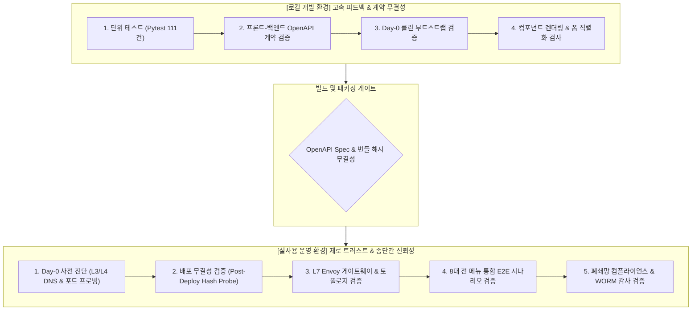

# Ordinatio 이원화 테스트 전략 및 실행 계획서 (Local vs. Production)
> **문서 번호:** `PRE_26_bifurcated_testing_strategy_local_vs_production.md`  
> **관련 문서:** `PRE_01_dashboard_engineering_plan.md`, `PRE_25_all_menus_integrated_test_scenario_and_monitoring_plan.md`  
> **작성일:** 2026-11-20  
> **상태:** 확정 및 이행 계획 수립

---

## 1. 개요 및 배경

그동안 백엔드 단위 테스트(Pytest 111건)와 프론트엔드 빌드(`npm run build`)가 100% 통과했음에도 불구하고, 실제 환경 배포 및 구동 시 **API 계약 불일치(404, FK 에러), VPC 내부 DNS 해석 실패(502), 배포 침묵 실패(구버전 잔존), 포트 번호 오표기** 등의 결함이 발생했습니다.

이를 원천 방지하기 위해 테스트의 목적과 책임을 **[로컬 개발 환경]**과 **[실사용 운영 환경]**으로 명확히 이원화(Bi-furcated Testing Strategy)하고 상호 보완적인 품질 게이트(Quality Gate)를 수립합니다.

---

## 2. 로컬 vs 실사용 환경 테스트 비교 매트릭스

| 구분 | 로컬 개발 환경 (Local Strategy) | 실사용 운영 환경 (Production Strategy) |
|:---|:---|:---|
| **핵심 목표** | • 개발 생산성 및 초단위 고속 피드백 • 코드 레벨 비즈니스 로직 검증 • 프론트-백엔드 간 인터페이스 계약 준수 | • 실제 L3/L4 네트워크 토폴로지 호환성 • 실제 vLLM/Ollama 모델 서빙 연동성 • 폐쇄망 보안(에어갭, DNS, PII, WORM) 검증 |
| **테스트 대상** | • 단일 머신, Docker Compose 스택 • 메모리 DB(SQLite) 또는 로컬 Postgres • 가상 업스트림(Mock HTTPX) | • AWS ELB / 사내 리버스 프록시 배후 • VPC 내부 DNS Resolver (`10.10.0.2`) • 실제 서빙 노드 (vLLM 클러스터) |
| **실행 주기** | • 코드 수정 시 즉시 (Git Pre-commit, PR) | • 패치 배포 직후, 정기 유지보수, 테넌트 온보딩 시 |
| **소요 시간** | • 1분 이내 (Target: < 30s) | • 3분 ~ 5분 (실제 LLM 추론 시간 포함) |

---

## 3. 로컬 테스트 전략 (Local Testing Strategy)

로컬 환경은 **"빠른 반복(Fast Iteration)"**과 **"인터페이스 계약 무결성(Contract Integrity)"**에 집중합니다.

### 3.1 세부 테스트 계층
1. **백엔드 단위/통합 테스트 (Pytest 111건)**:
   - `make test` (`cd backend && uv run pytest -v`)
   - 인텐트 분류, 가상키 Argon2id 해싱, 분산 레이트리밋, 토큰 과금 검증
2. **프론트-백엔드 OpenAPI 계약 검증 (Contract Integrity Test - 신규)**:
   - 프론트엔드 `apiClient`의 모든 URL/메서드가 백엔드 `openapi.json`에 100% 실존하는지 정적 대조 (비밀번호 초기화 404 원천 방지)
   - 폼 데이터 미선택 시 `""` 대신 `null` 직렬화 검증 (FK 위반 방지)
3. **Day-0 클린 부트스트랩 검증 (Clean-slate Test - 신규)**:
   - `.env` 부재 시 자동 생성 동작 및 포트 충돌(`5173`, `8000`, `8080`, `5432`) 사전 점검

---

## 4. 실사용 운영 환경 테스트 전략 (Production Strategy)

실환경은 **"인프라 런타임 제약(Network/DNS/ELB)"**과 **"실제 LLM 트래픽 처리(Real Ingress)"**에 집중합니다.

### 4.1 세부 테스트 계층
1. **Day-0 인프라 및 네트워크 프로빙 (Preflight Probing)**:
   - 도커 컨테이너 내부에서 VPC DNS Resolver (`10.10.0.2:53`) 정상 질의 확인
   - 모델 등록 시 백엔드가 대상 엔드포인트로 실제 TCP/HTTP 연결 가능 여부 사전 핑 검증
2. **배포 후 아티팩트 무결성 검증 (Post-Deploy Integrity Probe - 신규)**:
   - 컨테이너 내부의 JS 번들 해시(SHA-256) 및 백엔드 `/api/v1/system/info` 버전 대조
   - 배포 침묵 실패(Silent Failure) 원천 차단
3. **L7 Envoy 게이트웨이 및 실제 토폴로지 검증**:
   - ELB 접속 시 웹 콘솔에서 항상 Envoy 인그레스 포트(`:8080`)로 안내되는지 확인
   - 가상키(`sk-ord-...`) 기반 L7 ext_proc, PII 마스킹, 토큰 미터링 실호출
4. **8대 전 메뉴 통합 운영 E2E 시나리오**:
   - `python3 scripts/verify_all_menus_integration_scenario.py`
5. **컴플라이언스 및 오프라인 패치 서명 검증**:
   - RSA-4096 서명 오프라인 핫픽스 번들 검증 (`make verify-phase5`)
   - 외부 SaaS 호출 0건(에어갭 무결성) 검증
