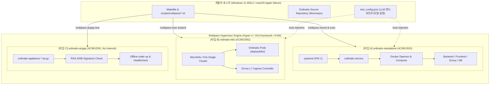
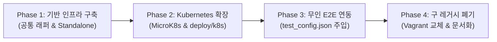

# PRE-27: Multipass 기반 크로스 플랫폼 통합 테스트베드 아키텍처 및 마이그레이션 계획서

본 문서는 **Ordinatio 폐쇄망 어플라이언스**의 모든 검증 환경을 Canonical의 경량 가상머신 오케스트레이터인 **Multipass** 기반으로 일원화하기 위한 소프트웨어 공학적 아키텍처 및 마이그레이션 계획서입니다.

---

## 1. 추진 배경 및 필요성

### 1.1 기존 테스트 환경의 한계점
1. **VirtualBox / Vagrant 환경의 종속성 및 구동 불능**:
   - Windows 11 WSL2 환경에서는 VirtualBox 가상화 충돌 및 중첩 가상화 미지원으로 Vagrant VM 프로비저닝이 원천 불가.
   - macOS(특히 Apple Silicon M1/M2/M3/M4)에서는 VirtualBox가 정상 구동되지 않아 팀 내 환경 분열 발생.
2. **호스트 Docker 컨테이너의 `systemctl` 검증 불가**:
   - 일반 Docker 컨테이너는 PID 1이 `systemd`가 아니므로, 실제 어플라이언스의 핵심 요구사항인 `systemctl status ordinatio`, 서비스 등록, 방화벽(firewalld), OS 부팅 시 자동 시작 라이프사이클을 검증할 수 없음.
3. **호스트 환경 오염 및 포트 충돌**:
   - 로컬 호스트에서 Docker Compose 구동 시 기존 사용 중인 포트(5173, 8000, 8080)와 충돌 발생 위험 상존.

### 1.2 Multipass 도입의 전략적 가치
- **크로스 플랫폼 네이티브 가상화**:
  - Windows 11: **Hyper-V / QEMU** 엔진
  - macOS: **Virtualization.framework / Hypervisor.framework** 엔진
  - Linux 호스트: **KVM** 엔진
- **완벽한 `systemd` 및 Docker 중첩 지원**:
  - 실제 클린 Ubuntu/Linux VM이 부팅되므로 `systemctl enable --now ordinatio`와 `docker compose` 스택이 고객사 실제 서버와 100% 동일하게 동작.
- **호스트 오염 제로(Zero Host Pollution)**:
  - 전용 사설 IP를 가진 독립 VM 내부에서 테스트가 수행되며, 테스트 종료 후 `multipass purge` 한 줄로 1초 만에 완전 소멸.

---

## 2. Multipass 기반 3대 테스트 하위 시스템 아키텍처



### 2.1 테스트베드 타입별 세부 규격

| 구분 | 타입 A: Standalone 모드 | 타입 B: Kubernetes 모드 | 타입 C: 에어갭 오프라인 번들 |
| :--- | :--- | :--- | :--- |
| **인스턴스명** | `ordinatio-standalone` | `ordinatio-k8s` | `ordinatio-airgap` |
| **기본 스펙** | 4 vCPU / 8 GB RAM / 20 GB Disk | 4 vCPU / 8 GB RAM / 30 GB Disk | 4 vCPU / 8 GB RAM / 20 GB Disk |
| **기반 OS** | Ubuntu 24.04 LTS (Noble) | Ubuntu 24.04 LTS (MicroK8s) | Ubuntu 24.04 LTS (인터넷 차단) |
| **핵심 검증 대상** | `install.sh`, `systemctl status ordinatio`, Docker Compose 데몬 | `deploy/k8s/` 매니페스트, Pod 라이프사이클, Envoy 라우팅 | `.tar.gz` 무결성, RSA-4096 서명, Zero-SaaS 에어갭 자립성 |
| **소요 시간** | 약 90초 (VM 생성 ~ 검증 완료) | 약 120초 (K8s 구동 ~ Pod Ready) | 약 90초 (오프라인 로드 ~ 헬스체크) |

---

## 3. 엔지니어링 표준화 및 자동화 인터페이스 명세

### 3.1 디렉토리 구조 신설
```
ordinatio/
├── scripts/
│   ├── multipass/
│   │   ├── mp-common.sh        # 호스트 OS 감지, Multipass 실행자 래퍼, 에러 핸들러
│   │   ├── mp-setup.sh         # Multipass 설치 상태 확인 및 브릿지/드라이버 점검
│   │   ├── mp-standalone.sh    # 타입 A: Standalone VM 생성 -> install.sh -> systemctl 검증
│   │   ├── mp-k8s.sh           # 타입 B: K8s VM 생성 -> MicroK8s 세팅 -> k8s-deploy 검증
│   │   ├── mp-verify-all.sh    # 8대 전 메뉴 무인 E2E 통합 시나리오 VM 원격 실행
│   │   ├── mp-airgap.sh        # 타입 C: 오프라인 에어갭 번들 무결성 검증
│   │   └── mp-teardown.sh      # 테스트 VM 안전 회수 및 purge
```

### 3.2 Makefile 타깃 표준화
```makefile
# ==============================================================================
# Multipass Unified Virtualization Testbed (Cross-Platform: Win11/WSL2 & macOS)
# ==============================================================================
.PHONY: mp-setup mp-standalone mp-k8s mp-verify-all mp-airgap mp-clean

mp-setup:
	@bash scripts/multipass/mp-setup.sh

mp-standalone:
	@bash scripts/multipass/mp-standalone.sh $(if $(CONFIG),--config $(CONFIG),)

mp-k8s:
	@bash scripts/multipass/mp-k8s.sh

mp-verify-all:
	@bash scripts/multipass/mp-verify-all.sh $(if $(CONFIG),--config $(CONFIG),)

mp-airgap:
	@bash scripts/multipass/mp-airgap.sh

mp-clean:
	@bash scripts/multipass/mp-teardown.sh
```

---

## 4. 4단계 세부 마이그레이션 로드맵



### Phase 1: Multipass 기반 스크립트 프레임워크 및 Standalone 모드 이관
- **과업 1.1**: `mp-common.sh` 구현 (Windows WSL에서는 `multipass.exe`, Mac/Linux에서는 `multipass` 자동 분기 및 권한 처리).
- **과업 1.2**: `mp-standalone.sh` 구현:
  - VM 생성 ➔ Docker Engine 설치 ➔ 호스트 소스 마운트 ➔ `install.sh --auto-approve` 실행.
  - `systemctl status ordinatio`, `docker ps`, 4대 헬스체크 포트(5173, 8000, 8080, 9901) 검증.
- **과업 1.3**: `ordinatio/Makefile`에 `mp-standalone`, `mp-clean` 타깃 연동.

### Phase 2: Kubernetes(MicroK8s) 클러스터 배포 환경 구축
- **과업 2.1**: `mp-k8s.sh` 구현 (MicroK8s 블루프린트 활용하여 즉시 K8s 노드 프로비저닝).
- **과업 2.2**: `deploy/k8s/` 매니페스트 배포 (`kubectl apply -f deploy/k8s/`).
- **과업 2.3**: Backend, Frontend, Envoy Ingress, Postgres, Redis Pod 100% Running 검증.
- **과업 2.4**: 호스트 `~/.kube/config` 연동 옵션 제공.

### Phase 3: 무인 E2E 통합 시나리오 (`test_config.json`) 및 외부 주입 연동
- **과업 3.1**: `mp-verify-all.sh` 구현:
  - Multipass VM 내부로 `test_config.json`을 마운트/복사.
  - VM 내부에서 `python3 scripts/verify_all_menus_integration_scenario.py --config test_config.json` 실행.
  - 관리자 JWT 인증, 사용자 지정 LLM 타깃 바인딩, WORM 감사, FinOps 과금, 핫픽스 서명 10/10 PASS 검증.

### Phase 4: 구형 Vagrant/VirtualBox 스크립트 정리 및 아키텍처 문서 현행화
- **과업 4.1**: `scripts/verify-standalone-install.sh` 내 가상화 프로바이더 검증 로직을 Multipass로 교체.
- **과업 4.2**: 아키텍처 문서 동기화:
  - `PRE_27_multipass_based_unified_testing_architecture_and_migration_plan.md` 신설.
  - `architecture/README.md` 및 `ordinatio/README.md`에 Multipass 원클릭 검증 명령어 반영.

---

## 5. Definition of Done (DoD) 및 리스크 관리

### 5.1 완료 기준 (DoD)
1. **명령어 일원화**: Windows 11(WSL2) 및 macOS에서 `make mp-standalone` 실행 시 동일하게 100% PASS 달성.
2. **systemctl 무결성**: 가상머신 내부에서 `systemctl status ordinatio`가 `Active: active (running)` 상태로 확인될 것.
3. **K8s 클러스터 무결성**: `make mp-k8s` 실행 시 5개 핵심 컴포넌트 Pod가 모두 정상 가동될 것.
4. **자원 정리 보장**: 테스트 실패 또는 성공 후 `make mp-clean` 수행 시 모든 임시 VM과 마운트가 완전 폐기될 것.

### 5.2 리스크 및 완화 방안
- **호스트 디스크 공간 부족**:
  - 완화책: VM 생성 시 `--disk 20G`로 컴팩트하게 제한하고, 테스트 직후 `multipass purge`를 자동 실행하도록 스크립트 작성.
- **Hyper-V / VirtualBox 포트 충돌**:
  - 완화책: Multipass VM은 자체 격리 브리지 IP를 가지므로 호스트 포트를 직접 점유하지 않고 `multipass info`를 통해 할당된 VM IP로 독립 통신하여 포트 충돌 원천 방지.
