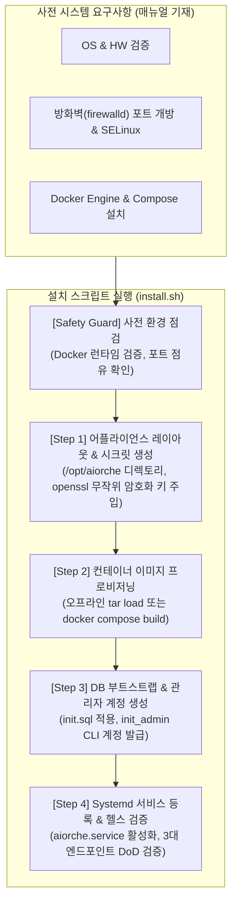

# PRE_31: RHEL 호환 계열 리눅스 단일 호스트 Standalone 모드 전자동 설치 스크립트 개발 계획서 (Single-Host Standalone Docker Appliance Installer Plan)

## 1. 엔지니어링 개요 (Standalone Mode Definition & Objectives)

본 문서는 고객사 폐쇄망(Air-Gapped) 온프레미스 인프라에 배포되는 **AI Orchestrator (aiorche)**를 별도의 분산 인프라나 복잡한 K8s 클러스터 없이, **단일 호스트(Single Host)에서 모든 구성요소를 Docker 컨테이너로 완결 구동시키는 「Standalone 모드 (Standalone Appliance Mode)」**의 엔지니어링 설치 계획서입니다.

### 1.1 핵심 역할 분리 및 설계 원칙 (Separation of Concerns)
본 계획서는 인프라 준비 단계와 어플라이언스 설치 단계를 엄격히 분리합니다:
1. **[인프라 계층: System Requirements]**:
   - OS 배포판 판별, 하드웨어 자원 확보, 방화벽(firewalld) 포트 개방, SELinux 보안 정책, Docker Engine 및 Docker Compose 플러그인 준비는 **고객사 인프라 엔지니어를 위한 「설치 전 사전 요구사항 매뉴얼(Pre-requisites Manual)」**로 명확히 분리하여 문서화합니다.
2. **[어플라이언스 계층: Installer Script]**:
   - 실제 배포 스크립트(`install.sh`)는 사전 요구사항이 충족된 호스트 환경을 전제로 하여, **어플라이언스 레이아웃 배치, 동적 시크릿 생성, 컨테이너 이미지 로드, DB 부트스트랩/관리자 계정 발급, Systemd 서비스 등록**부터 집중 수행합니다.
   - (단, 스크립트 진입 시 사전 요구조건(Docker 설치 여부, 포트 점유 등)이 충족되었는지 검증하는 **비침습적 가드(Safety Guard)** 로직을 포함합니다.)

---

## 2. [System Requirements] 사전 시스템 요구사항 및 호스트 준비 매뉴얼

고객사 인프라 운영팀 또는 설치 담당자가 `install.sh` 실행 전에 호스트 서버에 사전에 구성해야 하는 공식 엔지니어링 규격 및 조치 매뉴얼입니다.

### 2.1 지원 OS 및 하드웨어 권장 사양
- **지원 운영체제 (Universal EL 9)**:
  - Red Hat Enterprise Linux (RHEL) 9.x
  - Rocky Linux 9.x
  - AlmaLinux 9.x
  - Oracle Linux 9.x (RHCK 및 UEK)
  - CentOS Stream 9
- **최소 및 권장 하드웨어 사양**:
  | 리소스 항목 | 최소 요구 사양 (PoC/테스트) | 프로덕션 권장 사양 |
  | :--- | :--- | :--- |
  | **CPU (vCPU)** | 2 Cores | **4 Cores 이상** |
  | **Memory (RAM)** | 4 GB (실가용 3.5GB 이상) | **8 GB ~ 16 GB** |
  | **Disk Storage** | 30 GB 여유 공간 (`/opt` 마운트) | **50 GB ~ 100 GB SSD** |
  | **Network** | 1 Gbps NIC, 고정 IP 권장 | 10 Gbps NIC, 192.168.x.x 대역 |

### 2.2 사전 인프라 준비 매뉴얼 (Host Preparation Commands)

#### (1) 필수 유틸리티 패키지 설치
호스트 OS 쉘에서 기본 관리 도구를 설치합니다:
```bash
sudo dnf install -y curl tar gzip jq procps-ng net-tools git openssl
```

#### (2) 방화벽(firewalld) 서비스 포트 개방
AI Orchestrator 외부 접점 포트를 방화벽에 등록합니다:
```bash
sudo systemctl enable --now firewalld
sudo firewall-cmd --permanent --add-port=80/tcp    # 어드민 웹 포털 (HTTP)
sudo firewall-cmd --permanent --add-port=8000/tcp  # 백엔드 REST API / Swagger
sudo firewall-cmd --permanent --add-port=8080/tcp  # Envoy L7 AI Gateway Ingress
sudo firewall-cmd --permanent --add-port=9901/tcp  # Envoy Admin & Prometheus 메트릭
sudo firewall-cmd --reload
```
> [!NOTE]
> PostgreSQL(5432) 및 Redis(6379)는 단일 호스트 내부 루프백(`127.0.0.1`) 전용으로 격리되므로 외부 방화벽 포트를 개방할 필요가 없습니다.

#### (3) SELinux 보안 정책 설정
RHEL 계열의 SELinux Enforcing 모드에서 컨테이너 볼륨 마운트가 원활히 작동하도록 설정합니다:
```bash
# 컨테이너의 cgroup 제어 허용
sudo setsebool -P container_manage_cgroup 1 2>/dev/null || true

# 어플라이언스 기본 데이터 디렉토리 생성 및 SELinux 컨테이너 레이블 지정
sudo mkdir -p /opt/aiorche/data
sudo chcon -Rt svirt_sandbox_file_t /opt/aiorche/data 2>/dev/null || true
```

#### (4) Docker Engine 및 Docker Compose 플러그인 준비
- **온라인 환경일 경우 (공식 CentOS/RHEL 저장소 활용)**:
  ```bash
  sudo dnf install -y yum-utils
  sudo yum-config-manager --add-repo https://download.docker.com/linux/centos/docker-ce.repo
  sudo dnf install -y docker-ce docker-ce-cli containerd.io docker-compose-plugin
  sudo systemctl enable --now docker
  ```
- **순수 폐쇄망(Air-Gapped) 환경일 경우**:
  - 고객사 내부 폐쇄망 사내 미러 저장소 또는 사전에 수령한 RPM 아카이브 디렉토리에서 설치:
  ```bash
  sudo dnf localinstall -y /path/to/offline-rpms/*.rpm
  sudo systemctl enable --now docker
  ```

---

## 3. [Installer Script Architecture] Standalone 설치 스크립트 실행 파이프라인

사전 요구사항이 갖춰진 호스트에서 구동되는 단일 설치 스크립트(`aiorche/deploy/standalone/install.sh`)는 어플라이언스 배치 및 초기화 단계에 집중하여 아래 **4단계(Step 1 ~ Step 4)**로 실행됩니다.



### 3.1 단계별 상세 동작 사양

#### [Safety Guard] 비침습적 환경 검증 (Pre-requisite Assertion)
스크립트 시작 직후 호스트 환경이 충족되었는지 비침습적으로 검사합니다 (OS 패키지를 임의 설치하지 않음):
- Docker 데몬 동작 여부 검사 (`docker info` 실패 시 안내 메시지와 함께 중단).
- Docker Compose v2 플러그인 설치 여부 확인 (`docker compose version`).
- 필수 포트(80, 8000, 8080, 9901)의 타 프로세스 점유 여부 확인 (`ss -tulpn` 충돌 시 경고).

#### [Step 1] 어플라이언스 레이아웃 배치 및 동적 시크릿 생성
- `/opt/aiorche/`에 Standalone 표준 런타임 디렉토리 트리 구성:
  ```
  /opt/aiorche/
  ├── docker-compose.standalone.yml   # Standalone 전용 5대 컨테이너 Compose
  ├── .env                            # 암호화 키가 동적 주입된 프로덕션 설정
  ├── deploy/
  │   ├── postgres/init.sql           # DB DDL 및 초기 데이터
  │   └── envoy/envoy.yaml            # L7 Gateway 설정
  ├── data/                           # 영구 볼륨 (호스트 보관)
  │   ├── postgres/
  │   ├── logs/
  │   └── worm_audit/
  └── bin/
      └── aiorche-ctl                 # 호스트 관리 CLI
  ```
- **동적 암호화 시크릿 생성 (`openssl rand -hex 32`)**:
  - `POSTGRES_PASSWORD`: 안전한 32바이트 영숫자 무작위 생성
  - `JWT_SECRET_KEY`: RBAC 관리자 토큰 서명 키 생성
  - `PII_MASKING_SALT`: PII SHA-256 마스킹 해시 솔트 생성
  - `WORM_SIGNING_KEY`: WORM 감사 로그 SHA-256 체이닝 키 생성
  - 생성된 키는 `/opt/aiorche/.env` 파일에 안전하게 주입(권한 `600`).

#### [Step 2] 컨테이너 이미지 프로비저닝 (Image Loading / Build)
- **에어갭 오프라인 아카이브 모드**:
  - 배포 패키지 내 `aiorche-standalone-images.tar.gz`가 존재할 경우:
    ```bash
    docker load -i aiorche-standalone-images.tar.gz
    ```
- **소스/온라인 빌드 모드**:
  - 아카이브가 없는 경우 소스로부터 즉시 이미지 빌드:
    ```bash
    docker compose -f /opt/aiorche/docker-compose.standalone.yml build
    ```

#### [Step 3] 데이터베이스 부트스트랩 및 관리자 계정 발급 (DB Bootstrap & RBAC)
- PostgreSQL 및 Redis 컨테이너 우선 기동 및 헬스 대기:
  ```bash
  docker compose -f /opt/aiorche/docker-compose.standalone.yml up -d postgres redis
  # pg_isready 프로빙 루프 대기 (최대 30초)
  ```
- 메타스토어 초기 DDL 스키마 적용 및 백엔드 기동.
- 슈퍼관리자(Super Admin) 계정 생성:
  - 백엔드 내부 CLI(`python -m app.scripts.init_admin`) 구동.
  - 기본 계정: `admin@aiorche.local`
  - 비밀번호: 안전한 무작위 영숫자(또는 `--admin-password` 인자 값)로 발급 후 기록.

#### [Step 4] Systemd 서비스 등록 및 헬스 무결성 검증 (Systemd & Post-Check)
- 호스트의 부팅 시 자동 시작 및 장애 복구를 위한 `/etc/systemd/system/aiorche.service` 유닛 파일 생성:
  ```ini
  [Unit]
  Description=AI Orchestrator Standalone Appliance
  Requires=docker.service
  After=docker.service network-online.target

  [Service]
  Type=oneshot
  RemainAfterExit=yes
  WorkingDirectory=/opt/aiorche
  ExecStart=/usr/bin/docker compose -f docker-compose.standalone.yml up -d
  ExecStop=/usr/bin/docker compose -f docker-compose.standalone.yml down
  ExecReload=/usr/bin/docker compose -f docker-compose.standalone.yml restart

  [Install]
  WantedBy=multi-user.target
  ```
- `systemctl daemon-reload && systemctl enable --now aiorche` 실행.
- **DoD 무결성 검증 (3대 엔드포인트 헬스체크)**:
  1. Frontend Web: `curl -s -o /dev/null -w "%{http_code}" http://localhost/` (200 OK)
  2. Backend REST: `curl -s http://localhost:8000/health` ({"status":"healthy"})
  3. Envoy Gateway: `curl -s http://localhost:9901/ready` (LIVE)
- 최종 설치 완료 요약 카드 및 브라우저 접속 URL, 슈퍼관리자 초기 비밀번호 출력.

---

## 4. 호스트 수명주기 관리 도구 (`aiorche-ctl`) 설계

설치 완료 후 호스트 쉘에서 어플라이언스를 직관적으로 운영할 수 있도록 `/usr/local/bin/aiorche-ctl` 스크립트를 제공합니다:

```bash
# 기본 운영 명령어
aiorche-ctl status           # 5대 컨테이너 상태, 포트 점유, CPU/RAM 사용률
aiorche-ctl start            # systemctl start aiorche 실행
aiorche-ctl stop             # systemctl stop aiorche 실행 (데이터 보존)
aiorche-ctl restart          # 전체 스택 재기동
aiorche-ctl logs -f [service] # 특정 서비스(backend, envoy 등) 로그 실시간 스트리밍
aiorche-ctl reset-admin      # 슈퍼관리자 비밀번호 재설정
aiorche-ctl backup           # DB 및 WORM 감사 로그 암호화 백업 아카이브 생성
aiorche-ctl verify           # 내장 DoD 검증 스크립트 실행
```

---

## 5. Vagrant 기반 테스트베드 및 프로비저닝 구조

Vagrant 환경에서는 `provision.sh`가 매뉴얼에 기재된 [System Requirements] 설정(방화벽, SELinux, Docker)을 먼저 수행한 후, Standalone `install.sh`를 호출하도록 구성합니다:

```ruby
# aiorche/deploy/vagrant/Vagrantfile
Vagrant.configure("2") do |config|
  config.vm.box = ENV['EL_DISTRO'] || "rockylinux/9"
  config.vm.hostname = "aiorche-standalone"
  config.vm.network "private_network", ip: "192.168.56.10"

  # 호스트 포트포워딩
  config.vm.network "forwarded_port", guest: 80, host: 8080, id: "dashboard"
  config.vm.network "forwarded_port", guest: 8000, host: 8000, id: "backend-api"
  config.vm.network "forwarded_port", guest: 8080, host: 8888, id: "envoy-gateway"
  config.vm.network "forwarded_port", guest: 9901, host: 9901, id: "envoy-admin"

  config.vm.provider "virtualbox" do |vb|
    vb.name = "aiorche-standalone-appliance"
    vb.cpus = 4
    vb.memory = 8192
  end

  # 프로비저닝: 1) 사전 환경 설정 -> 2) Standalone install.sh 실행
  config.vm.provision "shell", path: "provision.sh"
end
```

---

## 6. 개발 마일스톤 및 산출물 정의

| 단계 | 작업 항목 | 세부 산출물 | 완료 기준 (DoD) |
| :---: | :--- | :--- | :--- |
| **M1** | **사전 요구사항 매뉴얼 작성** | `aiorche/deploy/standalone/PREREQUISITES.md` | RHEL 9 계열 패키지/방화벽/SELinux/Docker 가이드 완비 |
| **M2** | **Standalone Compose & 환경 템플릿** | `aiorche/deploy/standalone/docker-compose.standalone.yml`<br>`aiorche/deploy/standalone/.env.template` | 단일 호스트 네트워크 및 로컬 루프백 바인딩 완결 |
| **M3** | **Standalone 설치 스크립트 개발** | `aiorche/deploy/standalone/install.sh` | Safety Guard 검증 후 Step 1 ~ Step 4 무인 설치 완결 |
| **M4** | **호스트 관리 CLI 구현** | `aiorche/deploy/standalone/aiorche-ctl` | `status`, `start`, `stop`, `logs`, `verify` 등 정상 구동 |
| **M5** | **Vagrant 테스트베드 연동** | `aiorche/deploy/vagrant/Vagrantfile`<br>`aiorche/deploy/vagrant/provision.sh` | `vagrant up` 실행 시 사전 설정부터 install.sh까지 원클릭 검증 완료 |
| **M6** | **DoD 종합 검증 및 문서 동기화** | `scripts/verify-standalone-install.sh`<br>`architecture/README.md` | 호스트 브라우저에서 대시보드 로그인 및 86개 테스트 100% 통과 |
