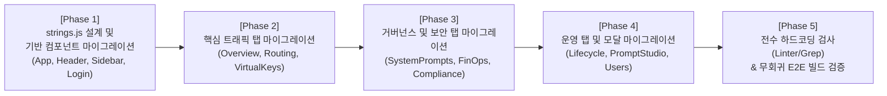

# PRE_34: 프론트엔드 UI 한글 텍스트 전수 `strings.js` 중앙 집중화 및 로컬라이제이션 엔지니어링 계획서 (Frontend UI Strings Centralization & Localization Plan)

## 1. 계획 개요 및 배경 (Executive Summary & Problem Statement)

본 문서는 AI Orchestrator의 관리자 웹 콘솔(`aiorche/frontend/`) 내 모든 컴포넌트에 하드코딩되어 분산되어 있는 한글 텍스트(화면 타이틀, 메뉴명, 버튼 라벨, 테이블 헤더, 안내 문구, 알림/에러 메시지 등)를 단일 리소스 파일인 **`strings.js`**로 전수 추출하여 중앙 집중식으로 관리하도록 개선하기 위한 **프론트엔드 로컬라이제이션 리팩토링 계획서**입니다.

### 1.1 현행 하드코딩의 문제점 및 기술 부채
1. **유지보수성 저하**: UI 문구 수정이나 금융/공공 표준 용어 정비 시 여러 JSX 컴포넌트를 직접 찾아 수정해야 함.
2. **용어 불일치 및 오탈자 위험**: 동일한 개념(예: "가상 키" vs "가상 API Key", "마스킹" vs "가명화")에 대해 화면별 표기가 일치하지 않을 위험 존재.
3. **다국어(i18n) 및 엔터프라이즈 화이트라벨링 제약**: 향후 영문(EN) 지원이나 고객사 커스텀 브랜딩/명칭 변경 시 전체 프론트엔드를 재작성해야 함.
4. **테스트 유지보수 취약성**: E2E 시나리오나 스크린샷 검증 시 하드코딩 문자열 변경이 예기치 못한 검증 실패를 유발할 수 있음.

### 1.2 핵심 엔지니어링 목표 (Design Goals)
- **Zero Hardcoded Korean Text in JSX**: JSX 템플릿 내부에서 한글 리터럴을 100% 제거하고 `strings.*` 네임스페이스 참조로 대체.
- **구조화된 도메인 네임스페이스**: 화면별/기능별 계층 구조를 갖춘 `strings.js` 스키마 수립.
- **동적 파라미터 함수화**: 동적 수치나 이름이 삽입되는 문구는 템플릿 리터럴 함수(`(count) => \`${count}건 처리\``)로 표준화.
- **100% 무회귀 빌드 및 E2E 통과**: 리팩토링 과정에서 기존 `data-testid` 및 UI 택소노미(`PRE_23`)를 원형 그대로 보존하여 `npm run build` 및 E2E 검증(`verify-all-menus.sh`) 100% PASS 유지.

---

## 2. `strings.js` 아키텍처 및 계층 구조 설계 (Schema & Taxonomy)

### 2.1 파일 배치 위치
```
aiorche/frontend/src/
├── constants/
│   └── strings.js          # 프론트엔드 전사 UI 문자열 단일 참조 지점 (Single Source of Truth)
├── components/
│   ├── Header.jsx          # import { strings } from '../constants/strings';
│   └── ...
```

### 2.2 계층 구조(Hierarchy) 및 네임스페이스 정의

```javascript
// aiorche/frontend/src/constants/strings.js 구조 개요 예시
export const strings = {
  // 1. 공통 범용 요소 (버튼, 공통 상태, 모달 액션)
  common: {
    confirm: "확인",
    cancel: "취소",
    save: "저장",
    delete: "삭제",
    edit: "수정",
    close: "닫기",
    refresh: "새로고침",
    status: {
      active: "정상",
      warning: "경고",
      error: "오류",
      loading: "로딩 중...",
      healthy: "정상 가동",
      unhealthy: "장애 발생"
    },
    pagination: {
      next: "다음",
      prev: "이전"
    }
  },

  // 2. 인증 및 계정 (로그인 페이지, 세션, 로그아웃)
  auth: {
    loginTitle: "AI Orchestrator 로그인",
    loginSubtitle: "폐쇄망 엔터프라이즈 AI 제어 평면",
    usernamePlaceholder: "사용자 아이디 (이메일)",
    passwordPlaceholder: "비밀번호",
    loginButton: "로그인",
    logoutButton: "로그아웃",
    sessionExpired: "세션이 만료되었습니다. 다시 로그인해 주십시오.",
    loginFailed: (count) => `인증 실패 (${count}/5회). 5회 실패 시 15분간 계정이 잠깁니다.`
  },

  // 3. 내비게이션 및 헤더 (사이드바, 헤더 바)
  nav: {
    menuOverview: "관제 홈",
    menuRouting: "지능형 라우팅",
    menuVirtualKeys: "가상 키 & 테넌트",
    menuSystemPrompts: "시스템 프롬프트",
    menuFinOps: "FinOps & 비용",
    menuCompliance: "PII & 컴플라이언스",
    menuLifecycle: "수명주기 & 핫픽스",
    menuPromptStudio: "프롬프트 스튜디오",
    menuUsers: "사용자 & 권한 관리",
    datacenterBadge: "온프레미스 주전산센터",
    airgapBadge: "100% 에어갭 폐쇄망"
  },

  // 4. 개별 기능 탭별 상세 문자열 (8대 전 메뉴)
  overview: {
    systemHealth: "전체 시스템 상태",
    totalTokens: "누적 처리 토큰",
    activeRPS: "실시간 RPS",
    p95Latency: "P95 응답 지연",
    activeRoutes: "활성 라우팅 경로",
    // ...
  },
  routing: {
    routeListTitle: "지능형 L7 라우팅 정책 목록",
    addRouteButton: "새 라우트 등록",
    // ...
  },
  virtualKeys: {
    title: "가상 API Key 거버넌스",
    issueKeyButton: "신규 가상키 발급",
    // ...
  },
  systemPrompts: {
    title: "시스템 프롬프트 독립 거버넌스",
    createPrompt: "신규 프롬프트 템플릿 등록",
    // ...
  },
  finops: {
    title: "FinOps 토큰 비용 및 예산 거버넌스",
    exportCsv: "정산 내역 내보내기 (CSV)",
    // ...
  },
  compliance: {
    title: "인라인 PII 마스킹 & WORM 감사 포렌식",
    presidioMode: "Presidio 보안 필터 모드",
    // ...
  },
  lifecycle: {
    title: "어플라이언스 수명주기 및 긴급 핫픽스",
    uploadPatch: "RSA-4096 서명 패치 업로드",
    // ...
  },
  promptStudio: {
    title: "프롬프트 인터랙티브 스튜디오",
    executeTest: "추론 테스트 실행",
    // ...
  },
  users: {
    title: "사용자 계정 및 RBAC 권한 관리",
    addUserButton: "신규 사용자 추가",
    // ...
  }
};
```

---

## 3. 대상 컴포넌트 현황 및 추출 범위 (Target Scope)

총 **14개 컴포넌트** 내의 모든 사용자 대면 텍스트를 전수 교체합니다:

| 대상 컴포넌트 | 경로 | 추출 대상 텍스트 영역 |
| :--- | :--- | :--- |
| **App.jsx** | `src/App.jsx` | 탭 전환 헤더 툴팁, 전역 로딩 인디케이터 |
| **AuthContext.jsx** | `src/context/AuthContext.jsx` | 세션 경고, 인증 실패 토스트 메시지 |
| **Header.jsx** | `src/components/Header.jsx` | 데이터센터 상태 배지, 테넌트 선택 드롭다운, 사용자 프로필 |
| **Sidebar.jsx** | `src/components/Sidebar.jsx` | 8대 메뉴 명칭, 하단 버전/어플라이언스 정보 |
| **LoginPage.jsx** | `src/components/LoginPage.jsx` | 로그인 카드 타이틀, 인풋 플레이스홀더, 실패 경고, 보안 안내 |
| **OverviewTab.jsx** | `src/components/OverviewTab.jsx` | KPI 메트릭 카드(토큰, 비용, RPS), 차트 범례, 헬스 상태 요약 |
| **RoutingTab.jsx** | `src/components/RoutingTab.jsx` | 라우팅 정책 테이블, 모델 바인딩 모달, 인텐트 가중치 에디터 |
| **VirtualKeysTab.jsx** | `src/components/VirtualKeysTab.jsx` | 가상키 발급/수정 모달, 테넌트 쿼터 설정, 키 파기 경고 모달 |
| **SystemPromptsTab.jsx** | `src/components/SystemPromptsTab.jsx` | 프롬프트 카탈로그, L7 ext_proc 주입 모드, 버전 롤백 안내 |
| **FinOpsTab.jsx** | `src/components/FinOpsTab.jsx` | 모델별 토큰 단가표, Hard Cap 차단 예산, CSV 내보내기 안내 |
| **ComplianceTab.jsx** | `src/components/ComplianceTab.jsx` | PII 탐지 규칙 뱃지, 마스킹 시뮬레이터, WORM 포렌식 검증 안내 |
| **LifecycleTab.jsx** | `src/components/LifecycleTab.jsx` | 4단계 핫픽스 롤링 진행표, 서명 검증 상태, 서포트 번들 안내 |
| **PromptStudioTab.jsx** | `src/components/PromptStudioTab.jsx` | 가상키 선택 드롭다운, 모델 파라미터(Temp/TopP), 비교 뷰어 |
| **UsersTab.jsx** | `src/components/UsersTab.jsx` | RBAC 사용자 테이블, 권한(SUPER_ADMIN 등) 설명, 잠금 해제 안내 |

---

## 4. 단계별 실행 로드맵 (Phased Execution Plan)



### [Phase 1] `strings.js` 기반 구축 및 공통/인증 컴포넌트 전환
- `src/constants/strings.js` 파일 생성 및 `common`, `auth`, `nav` 네임스페이스 정의.
- `App.jsx`, `AuthContext.jsx`, `Header.jsx`, `Sidebar.jsx`, `LoginPage.jsx` 5개 파일의 한글 문자열 전수 추출 및 `strings.*` 치환.
- 1차 검증: 로그인 화면 및 사이드바 내비게이션 렌더링 무결성 확인.

### [Phase 2] 트래픽 및 제어 평면 탭 마이그레이션
- `strings.overview`, `strings.routing`, `strings.virtualKeys` 네임스페이스 정의.
- `OverviewTab.jsx`, `RoutingTab.jsx`, `VirtualKeysTab.jsx` 3개 컴포넌트의 한글 문자열 전수 치환.
- 2차 검증: 라우팅 정책 편집 및 가상키 발급 모달 정상 동작 확인.

### [Phase 3] 거버넌스 및 보안 컴플라이언스 탭 마이그레이션
- `strings.systemPrompts`, `strings.finops`, `strings.compliance` 네임스페이스 정의.
- `SystemPromptsTab.jsx`, `FinOpsTab.jsx`, `ComplianceTab.jsx` 3개 컴포넌트의 한글 문자열 전수 치환.
- 3차 검증: Presidio 마스킹 테스트 및 FinOps 단가표 계산기 정상 렌더링 확인.

### [Phase 4] 운영 수명주기 및 사용자 관리 탭 마이그레이션
- `strings.lifecycle`, `strings.promptStudio`, `strings.users` 네임스페이스 정의.
- `LifecycleTab.jsx`, `PromptStudioTab.jsx`, `UsersTab.jsx`, `GrafanaModal.jsx` 컴포넌트 한글 치환.
- 4차 검증: 핫픽스 업로드 UI 및 사용자 권한 수정 모달 정상 렌더링 확인.

### [Phase 5] 전수 하드코딩 잔여 검사 및 DoD 자동화 검증
- **잔여 한글 정적 분석**:
  ```bash
  # 컴포넌트 디렉토리 내 잔여 한글 리터럴 검색 (주석 제외)
  grep -r -E "['\"][^'\"]*[가-힣]+[^'\"]*['\"]" aiorche/frontend/src/components/ || true
  ```
- **프로덕션 빌드 검증**: `cd aiorche/frontend && npm run build` (dist/ 생성 및 번들링 무오류 확인).
- **종합 E2E 시나리오 검증**: `make verify-all-menus` 및 `make verify-auth-rbac` 100% PASS 확인.

---

## 5. 완료 기준 (Definition of Done - DoD)

1. **하드코딩 0건 달성**: `aiorche/frontend/src/components/` 내 JSX 태그 속성 및 텍스트 노드에 한글 리터럴이 1건도 존재하지 않고, 모두 `strings.*`로 참조될 것.
2. **단일 참조 지점 확립**: `aiorche/frontend/src/constants/strings.js` 내에 전사 UI 문자열이 체계적으로 정의되어 있을 것.
3. **프론트엔드 빌드 100% 무오류**: `npm run build` 시 문법 에러나 미참조 변수 없이 완벽한 번들 생성.
4. **기존 자동화 검증 100% 무회귀 통과**:
   - `make verify-all-menus` (10/10 Steps PASS)
   - `make verify-auth-rbac` (86/86 Tests PASS)
   - `make verify-standalone-install` (7/7 Tests PASS)

---

## 6. 결론 및 기대 효과

본 계획이 완료되면:
1. **문구 관리 생산성 극대화**: 마케팅/기획/운영팀의 텍스트 수정 요청을 코드 수정 없이 `strings.js` 단일 파일 수정만으로 즉각 처리 가능.
2. **용어 표준화 및 거버넌스 확립**: 어플라이언스 전반의 용어 표기가 표준화되어 금융/공공 감리 요건 완벽 충족.
3. **글로벌 다국어(i18n) 지원 기반 확보**: 향후 영문 번역 파일(`strings.en.js`)만 추가하면 단 몇 분 만에 영문 UI 토글 기능을 탑재할 수 있는 확장성 확보.

