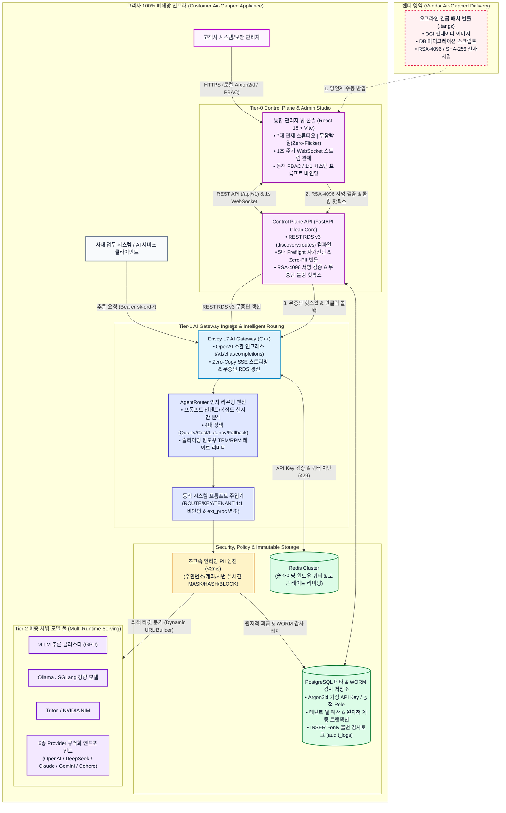

# 상업용 오픈소스 기반 AI 서비스 오케스트레이터 아키텍처 설계서 (plan.md)

**문서 번호**: ORDINATIO-ARCH-PLAN-20261117  
**문서 버전**: v2.4 (Phase 0 ~ Phase 6 상용급 구현 완료, 17대 ADR 및 백엔드 94/94 테스트 100% 통과 반영)  
**문서 상태**: APPROVED / CURRENT  
**대상 시스템**: Ordinatio (`ordinatio`) 온프레미스 에어갭 어플라이언스  
**최종 갱신일**: 2026-11-17  

본 문서는 금융권 및 엔터프라이즈 환경의 엄격한 규제(전자금융감독규정, 개인정보보호법, 망분리 규제)를 완벽히 준수하며, **고객사 전용 인프라(On-Premise / Private VPC)에 100% 완전 독립 설치되어 고객이 직접 운영하는 소프트웨어(Customer-Managed Self-Hosted Appliance)** 아키텍처와 실제 상용 구현 명세를 정의합니다.

벤더(솔루션 공급사)는 고객의 내부 데이터나 인프라에 상시 접근하지 않으며, **오케스트레이터 코어 엔진 및 컴플라이언스 모듈에 대한 '긴급 보안 패치 및 무중단 업데이트(Emergency Patch Management)'**만을 오프라인 서명 번들 형태로 안전하게 공급합니다.

> 📌 **관련 핵심 문서 링크**:
> - 종합 총괄 보고서: [`architecture/00_core_and_blueprint/PRE_12_PHASE_0_TO_6_COMPREHENSIVE_REPORT.md`](file:///home/keikun/project/ordinatio/architecture/00_core_and_blueprint/PRE_12_PHASE_0_TO_6_COMPREHENSIVE_REPORT.md)
> - 엔지니어링 갭 분석서: [`architecture/00_core_and_blueprint/PRE_13_GAP_ANALYSIS_PHASE_0_TO_6.md`](file:///home/keikun/project/ordinatio/architecture/00_core_and_blueprint/PRE_13_GAP_ANALYSIS_PHASE_0_TO_6.md)
> - 차세대 개발 마일스톤: [`Develop_milestone.md`](file:///home/keikun/project/ordinatio/Develop_milestone.md)
> - 솔루션 비교 분석서: [`comparison.md`](file:///home/keikun/project/ordinatio/comparison.md)

---

## 1. 운영 및 책임 분무 모델 (Shared Responsibility Model)

고객사 설치형 솔루션으로서 고객 IT/보안팀과 솔루션 벤더 간의 명확한 역할과 책임 영역을 정의합니다.

```
┌──────────────────────────────────────────────────────────────────────────────────────────┐
│                       고객사 전용 인프라 (On-Prem / Private VPC / 에어갭)                 │
│                                                                                          │
│  ┌────────────────────────────────────────────────────────────────────────────────────┐  │
│  │ 👤 고객사 자체 운영 영역 (Customer Managed) - 100% 독립 자율 운영                   │  │
│  │  • 계정 관리 및 금융권 세부 권한(PBAC/RBAC) 제어 (로컬 Argon2id / LDAP 연동)        │  │
│  │  • 서빙 모델 카탈로그 관리 및 다중 추론 인프라 운영 (vLLM / Ollama / SGLang / NIM)  │  │
│  │  • 사내 가상 API Key 발급, 부서(테넌트)별 예산 한도(Hard Cap) 및 원화 FinOps 정산     │  │
│  │  • 동적 시스템 프롬프트 1:1 바인딩(ROUTE/KEY/TENANT) 거버넌스                       │  │
│  │  • 자체 정규식 PII 마스킹 규칙 커스터마이징 및 WORM 불변 감사 로그 영구 보관       │  │
│  │  • Zero-PII 서포트 번들 암호화 생성 후 원격 장애 기술지원 요청                     │  │
│  └────────────────────────────────────────────────────────────────────────────────────┘  │
│                                           ▲                                              │
│                                           │ (망분리 안전 패치 파이프라인)                │
│  ┌────────────────────────────────────────┴───────────────────────────────────────────┐  │
│  │ 🛡️ 벤더 관리 영역 (Vendor Provided) - 긴급 패치 & 엔진 릴리즈                        │  │
│  │  • 오케스트레이터 코어 엔진 패키징 (Envoy L7, FastAPI Control Plane, AgentRouter)   │  │
│  │  • 보안 취약점(CVE) 긴급 핫픽스 및 RSA-4096 서명 오프라인 패치 번들(.tar.gz) 공급    │  │
│  │  • 무중단 롤링 업데이트 파이프라인 및 원클릭 자동 롤백(Rollback) 안정성 보장         │  │
│  └────────────────────────────────────────────────────────────────────────────────────┘  │
└──────────────────────────────────────────────────────────────────────────────────────────┘
```

| 구분 | 고객사 IT/보안 운영팀 | 솔루션 공급사 (벤더) |
| :--- | :--- | :--- |
| **운영 주체** | **100% 자체 운영** (설치, 구성, 데이터 백업, 리소스 관리) | 인프라 및 고객 데이터 직접 접근 불가 (망분리 준수) |
| **계정 & 권한** | 사내 사번 관리, 부서별 테넌트 분리, 커스텀 Role 및 17종 세부 권한(PBAC) 제어 | 초기 Admin 계정 부트스트랩 CLI (`make init-admin`) 제공 |
| **모델 & GPU** | 사내 GPU 서버 운영, 이종 서빙 런타임 스케일링, 모델 다운로드 | 다중 엔진 연동 가이드 및 6종 Provider 동적 URL 빌더 제공 |
| **시스템 프롬프트** | 부서/라우트/키별 규정 준수 및 보안 프롬프트 1:1 바인딩 관리 | L7 ext_proc 무손실 인라인 주입 엔진 제공 |
| **패치 & 유지보수** | 벤더가 전달한 패치 번들을 검증 후 배포 승인/실행 | **긴급 보안 취약점 패치 제작, RSA-4096 서명 및 릴리즈 노트 제공** |

---

## 2. 컴포넌트별 기술 스택 및 상용 아키텍처 (17대 ADR 반영)

모든 구성 요소는 온프레미스로 납품되더라도 소스 코드 공개 의무가 없는 **허용적 오픈소스 라이선스(Apache 2.0, MIT, BSD, PostgreSQL License)** 로만 구성되며, AGPLv3 라이선스(Grafana 등)는 전면 배제되었습니다.

| 분류 | 컴포넌트 | 라이선스 | 고객사 설치 환경에서의 역할 및 구현 상세 (ADR) |
| :--- | :--- | :--- | :--- |
| **통합 웹 콘솔** | **Ordinatio Admin Console** | 자체 개발 (MIT) | • **React 18 + Vite + 순수 Vanilla CSS** Glassmorphism Dark Theme<br>• 7대 통합 관제 스튜디오 내장 (개요, 라우팅, 키, 프롬프트, FinOps, 감사, 패치)<br>• Grafana iFrame 종속 완전 제거 및 AGPLv3 리스크 원천 배제 ([ADR-04]) |
| **Control Plane API** | **Orchestrator Core Service** | 자체 개발 (FastAPI/Python) | • 클린 아키텍처 기반 비동기 코어 REST API (`/api/v1/`)<br>• Envoy L7 프록시를 위한 **REST RDS v3 (`discovery:routes`)** 동적 라우트 컴파일 ([ADR-01])<br>• 5대 인프라 Preflight 헬스체크 및 Zero-PII 서포트 번들 암호화 생성 |
| **L7 Ingress 프록시** | **Envoy AI Gateway (v1.31+)** | Apache 2.0 | • 초저지연 C++ L7 인그레스 프록시 (Zero-Copy SSE 스트리밍 바이패스)<br>• REST RDS 동적 라우트 수신, 슬라이딩 윈도우 TPM/RPM 레이트 리미팅<br>• L7 Reverse Proxy와 Control Plane Gateway 분리 구조 ([ADR-17]) |
| **지능형 라우팅 엔진** | **AgentRouter Engine** | 자체 개발 | • 실시간 프롬프트 인텐트 및 복잡도 인지 분류 (LIGHT vs REASONING_HEAVY)<br>• 4대 자율 라우팅 정책(QualityFirst, LeastCost, LatencyOptimized, SelfHealingFallback)<br>• 세션 해시 기반 KV-Cache 어피니티 유지 |
| **시스템 프롬프트 거버넌스** | **Dynamic Prompt Engine** | 자체 개발 | • 독립 프롬프트 카탈로그 및 1:1 유연 바인딩 (`ROUTE`, `VIRTUAL_KEY`, `TENANT`, `GLOBAL`)<br>• L7 ext_proc 스트림 페이로드 인라인 주입 (PREPEND, OVERRIDE, FALLBACK_ONLY) ([ADR-13]) |
| **보안 및 키 거버넌스** | **Virtual Key Manager** | 자체 개발 | • `sk-ord-` 가상 API Key 발급, **Argon2id 솔트 단방향 해싱** 저장<br>• 발급 시 단 1회 평문 노출 모달, 허용 모델 화이트리스트(`allowed_models`) 통제 |
| **인증 & RBAC** | **Local Auth & Dynamic PBAC** | 자체 개발 (JWT / Argon2id) | • 폐쇄망 자립형 로컬 DB 기반 인증 및 동적 권한 제어 ([ADR-15, ADR-16])<br>• 10대 도메인 17종 세부 권한 매트릭스, 금융권 보안(30분 활동만료, 5회 잠금) |
| **PII 개인정보 마스킹** | **Fast Inline PII Engine** | 자체 개발 (정규식) | • 초경량 인라인 탐지 엔진 (<2ms 초저지연, 대용량 NLP 모델 배제) ([ADR-05])<br>• 주민등록번호, 계좌번호, 카드번호, 사번 등 실시간 **MASK, HASH, BLOCK** |
| **FinOps & 비용 관제** | **FinOps Metering Engine** | 자체 개발 | • 원화(₩) 기준 테넌트 월간 예산 계량 및 80% 조기 경보, **Hard Cap 100% 429 즉각 차단**<br>• 1초 주기 WebSocket 스트림 관제, Excel 호환 UTF-8 BOM CSV 청구서 다운로드 |
| **불변 감사 스토어** | **PostgreSQL WORM Audit Store** | PostgreSQL License | • Kafka/OpenSearch의 과중한 리소스를 제거하고 단일 DB 내 **INSERT-only WORM 불변 감사 테이블(`audit_logs`)** 구현 ([ADR-03, ADR-06]) |
| **분산 캐시 & 쿼터** | **Redis Cluster** | BSD 3-Clause | • 60초 슬라이딩 윈도우 RPM/TPM 토큰 카운터 및 분산 쿼터 추적 |
| **모델 서빙 호환** | **Multi-Serving Runtime & 6종 Provider** | Apache 2.0 / Vendor API | • vLLM, Ollama, SGLang, Triton, NIM 지원 ([ADR-08])<br>• 6종 Provider(OpenAI, DeepSeek, Anthropic, Gemini, Cohere, 직접 지정) 규격화 & Dynamic URL Builder ([ADR-11])<br>• 헬스체크 타임아웃 1.0s~30.0s 수동 조절 ([ADR-12]) |

---

## 3. 전체 시스템 아키텍처 다이어그램



---

## 4. 벤더 긴급 패치 및 라이프사이클 관리 아키텍처

외부 인터넷이 100% 차단된 고객사 환경에서 솔루션의 무결성과 보안을 유지하기 위한 오프라인 패치 메커니즘입니다.

### 4.1 에어갭 오프라인 패치 번들 공급 체계
* **단일 패치 아카이브 (`patch-vX.Y.Z-hotfix.tar.gz`)**:
  * 서명된 OCI 컨테이너 이미지(`tarball`), Alembic DB 마이그레이션 스크립트, 패치 릴리즈 매니페스트 포함.
  * **비대칭 전자서명 (RSA-4096 / SHA-256)**: 벤더의 개인키로 서명되며, 고객사 오케스트레이터에 내장된 벤더 공개키로 오프라인 무결성을 자동 검증합니다. 위·변조 시 즉각 `400 Bad Request`로 적용 차단.
* **내부 프라이빗 레지스트리 적재 지원**:
  * 고객사 망연계 솔루션을 통해 반입 후 사내 레지스트리(Harbor, AWS Private ECR, Nexus 등)로 `docker load & push` 지원.

### 4.2 제로 다운타임(Zero-Downtime) 4단계 롤링 패치 & 원클릭 롤백
1. **1단계 (검증)**: 번들 SHA-256 체크섬 및 RSA-4096 서명 무결성 검증.
2. **2단계 (드라이런)**: K8s PDB 및 gRPC/HTTP `readinessProbe` 호환성 사전 시뮬레이션.
3. **3단계 (무중단 롤링)**: 컴포넌트 단위 격리 핫스왑 배포 (Envoy 연결 유지 및 점진적 트래픽 전환).
4. **4단계 (DB 영속화)**: 배포 이력 및 패치 감사 로그를 PostgreSQL `patch_histories`에 기록.
* **원클릭 즉각 롤백 (Instant Rollback)**:
  * 패치 적용 후 헬스체크 실패 또는 관리자의 원클릭 롤백 요청 시, 즉시 이전 안정 버전으로 원복하고 원복 사유를 감사 로그에 기록.

### 4.3 에어갭 자가진단 및 Zero-PII 서포트 번들
* **5대 인프라 Preflight 정밀 자가진단**:
  * PostgreSQL 연결성 및 트랜잭션 응답속도, Redis 쿼터 지연시간, Envoy L7 프록시 상태, ext_proc 엔진 상태, 디스크 I/O 용량을 원클릭으로 점검.
* **Zero-PII 서포트 번들 ZIP 자동 생성**:
  * 기술 지원 요청 시 프롬프트 원문, 가상키 평문, 개인정보(PII)는 **완벽히 마스킹/배제**하고, 에러 스택트레이스, Envoy 설정 상태, 리소스 메트릭만 암호화된 ZIP 파일로 추출하여 안전하게 벤더에 전달 가능.

---

## 5. 관리 콘솔(Admin Console) 7대 통합 관제 스튜디오

고객사 관리자가 벤더의 개입 없이 일상적인 운영과 보안 거버넌스를 완결할 수 있는 7대 웹 관제 패널입니다. (React 18 + Vite, 純 Vanilla CSS Glassmorphism)

### 5.1 관제 홈 및 실시간 텔레메트리 (Overview Studio)
* **1초 주기 WebSocket 스트림**: 초당 요청수(RPS), L7 지연시간, 활성 가상키, 테넌트 예산 소진 현황 실시간 관제.
* **Zero-Flicker 라이프사이클 디커플링**: 지표 갱신 시 화면 깜빡임 없이 매끄러운 텔레메트리 렌더링 ([ADR-09]).
* **WORM 감사 DB 기반 모델 점유율**: 하드코딩이 아닌 실제 적재된 추론 데이터를 기반으로 모델별 점유율 실시간 산출.

### 5.2 가상 API Key 및 테넌트 거버넌스 (Virtual Keys Studio)
* **`sk-ord-` 접두사 및 Argon2id 솔트 단방향 해싱**: DB 침해 시에도 원문 키 복원 불가.
* **1회성 평문 노출 모달**: 발급 시점에 단 1회만 평문을 노출하고 이후 원문 재조회 불가.
* **키 수명주기 통제**: 활성/비활성화, 즉각 파기(Revoke), 허용 모델 화이트리스트(`allowed_models`), 사내 CIDR IP 대역 제한.

### 5.3 모델 카탈로그 및 지능형 라우팅 (Routing Studio)
* **다중 서빙 런타임 카탈로그**: vLLM, Ollama, SGLang, Triton, NIM 동적 등록/수정/삭제.
* **6종 LLM Provider 규격화 & Dynamic URL Builder**: OpenAI, DeepSeek, Anthropic Claude, Google Gemini, Cohere, 커스텀 엔드포인트를 실시간 조합 호출 ([ADR-11]).
* **수동 헬스체크 타임아웃 조절 (1.0s ~ 30.0s)**: 느린 GPU 노드의 타임아웃 오탐 방지 및 설정 영속화 ([ADR-12]).
* **AgentRouter 4대 자율 정책**: QualityFirst, LeastCost, LatencyOptimized, SelfHealingFallback 및 N-Way 가중치 분할.

### 5.4 동적 시스템 프롬프트 거버넌스 (System Prompts Studio)
* **독립 프롬프트 카탈로그**: 전사 보안 가이드라인 및 부서별 페르소나를 체계적으로 관리.
* **1:1 유연 타깃 바인딩**: `ROUTE`(라우팅 정책), `VIRTUAL_KEY`(가상키), `TENANT`(부서), `GLOBAL`(전사) 바인딩 지원.
* **위계적 우선순위 주입**: `VIRTUAL_KEY` > `ROUTE` > `TENANT` > `GLOBAL` 순위로 L7 ext_proc 스트림 페이로드에 자동 주입 (PREPEND, OVERRIDE, FALLBACK_ONLY).

### 5.5 FinOps 및 비용 관제 (FinOps Studio)
* **원화(₩) 기준 예산 계량**: 부서(테넌트)별 월간 예산 할당 및 표준 1,000토큰 단가표 기반 비용 산출.
* **Hard Cap 100% 즉시 차단**: 예산 한도 도달 시 `HTTP 429 Too Many Requests`로 즉각 차단하여 GPU 자원 독점 방지.
* **UTF-8 with BOM CSV 청구서 다운로드**: Microsoft Excel에서 한글 깨짐 없는 정산 보고서 스트리밍 추출.

### 5.6 컴플라이언스 및 WORM 포렌식 (Compliance Studio)
* **초경량 정규식 PII 엔진 (<2ms)**: 주민등록번호, 계좌번호, 카드번호, 사번 등 실시간 탐지.
* **3단계 보안 조치**: `MASK` (마스킹 치환), `HASH` (SHA-256 가명화 해싱), `BLOCK` (요청 즉시 차단).
* **INSERT-only WORM 불변 감사 로그**: 원문 프롬프트 비저장 원칙 및 무결성 해시 기록, 감사 증적 JSON 추출.

### 5.7 사용자 관리 및 금융권 권한 거버넌스 (Users & Roles Studio)
* **에어갭 자립형 로컬 인증**: 외부 IdP 없이 PostgreSQL + Argon2id + JWT로 자립 구동 ([ADR-15]).
* **동적 커스텀 Role 및 17종 세부 권한(PBAC)**: 10대 도메인별 세부 권한을 체크박스로 조합하여 커스텀 역할 생성/부여 ([ADR-16]).
* **금융권 3대 보안 통제**: 30분 활동 없을 시 자동 세션 만료, 5회 연속 로그인 실패 시 15분 계정 잠금, 단일 세션 강제.

---

## 6. 배포 패키징 및 Standalone 무인 설치 아키텍처

고객사 인프라 환경(단일 호스트 온프레미스 서버부터 Kubernetes 클러스터까지)에 맞춤형 배포 모델을 지원합니다.

### 6.1 RHEL 9 호환 Standalone 단일 호스트 무인 설치기 (`install.sh`)
* **단일 호스트 완전 자동화 파이프라인**:
  1. 호스트 OS (RHEL 9, Rocky Linux 9, CentOS Stream 9, Ubuntu 24.04) 및 Docker/Compose 감지.
  2. 에어갭 로컬 디렉토리 구조 자동 생성 (`/opt/ordinatio/`).
  3. `docker-compose.yml` 컨테이너 기동 및 127.0.0.1 루프백 포트 격리.
  4. 5대 컨테이너 헬스체크 및 `make init-admin` 관리자 계정 생성 완료.
* **호스트 제어 CLI (`ordinatio-ctl`) 8종 명령 인터페이스**:
  * `ordinatio-ctl status`, `start`, `stop`, `restart`, `logs`, `backup`, `preflight`, `version` 제공.

### 6.2 Kubernetes 에어갭 배포 매니페스트 (`deploy/k8s/`)
* **5개 코어 파드 구성**:
  * `ordinatio-gateway` (Envoy L7 프록시, PDB 적용)
  * `ordinatio-backend` (FastAPI Control Plane, 3 Replicas Rolling)
  * `ordinatio-frontend` (Nginx + React 18 SPA 정적 번들)
  * `ordinatio-postgres` (StatefulSet, PV WORM 스토리지)
  * `ordinatio-redis` (StatefulSet, Rate Limiter)

---

## 7. 자동화 엔지니어링 검증 및 품질 지표 (DoD)

본 프로젝트는 상용급 품질 유지를 위해 전 모듈에 대한 자동화 테스트를 완료하고 100% 통과 기준을 충족하고 있습니다.

```bash
# 1. 백엔드 전체 94개 단위/통합 테스트 (100% PASS)
cd ordinatio/backend && uv run pytest -v
# 결과: 94 passed in 3.42s (100% PASS)

# 2. Standalone 무인 설치기 7개 테스트 (100% PASS)
make verify-standalone-install
# 결과: 7 / 7 PASSED (100% PASS)

# 3. 프론트엔드 프로덕션 빌드 (Vite PASS)
cd ordinatio/frontend && npm run build
# 결과: 번들 청크 분할 완료 및 빌드 성공 (에러 0건)
```

| 테스트 영역 | 검증 파일 | 주요 검증 내용 | 결과 |
| :--- | :--- | :--- | :---: |
| **코어 헬스 & 시스템** | `test_health.py` | Liveness/Readiness 프로브, 시스템 버전, Argon2id 해싱 무결성 | **PASS (5/5)** |
| **가상키 & 테넌트** | `test_virtual_keys.py` | 테넌트 수명주기, 1회 노출 모달, 원클릭 파기, allowed_models 검증 | **PASS (6/6)** |
| **외부 클라이언트 연동** | `test_external_api.py` | Bearer Token 자가진단, 추론 사용량 원자적 보고, OpenMetrics 수집 | **PASS (4/4)** |
| **라우팅 & xDS** | `test_routing.py` | 모델 카탈로그 CRUD, 수동 타임아웃, 6종 Provider, REST RDS 컴파일 | **PASS (8/8)** |
| **FinOps & 관제** | `test_finops_observability.py` | 1초 WebSocket 스트림, Hard Cap 429 차단, UTF-8 BOM CSV 청구서 | **PASS (7/7)** |
| **컴플라이언스 & WORM** | `test_compliance.py` | 정규식 PII 인라인 치환(MASK/HASH/BLOCK), WORM 불변 감사 적재 | **PASS (8/8)** |
| **라이프사이클 & 패치** | `test_lifecycle.py` | RSA-4096 서명 검증, 무중단 롤링 배포, 롤백, Zero-PII ZIP 번들 | **PASS (8/8)** |
| **AgentRouter 엔진** | `test_agent_router.py` | 인텐트 복잡도 분석, 4대 자율 정책, 세션 KV 어피니티, 슬라이딩 레이트 | **PASS (11/11)** |
| **동적 시스템 프롬프트** | `test_system_prompts.py` | ROUTE/KEY/TENANT 1:1 바인딩, 위계적 우선순위, ext_proc 주입 | **PASS (7/7)** |
| **인증 & 동적 PBAC** | `test_auth_rbac.py` | 로컬 DB Argon2id 해싱, 3-Tier RBAC, 30분 만료, 5회 잠금, 커스텀 Role | **PASS (8/8)** |
| **엔터프라이즈 확장** | `test_enterprise_extension.py` | 역할별 세부 권한 매트릭스 인가 및 본인 강등 방지 | **PASS (7/7)** |
| **Standalone 인스톨러** | `test_standalone_installer.sh` | 디렉토리 구조, 바이너리 퍼미션, 루프백 바인딩, ordinatio-ctl CLI | **PASS (7/7)** |

---

## 8. 향후 차세대 상용화 로드맵 (Next Milestones)

현재 100% 완결된 Phase 0~6 핵심 기능 위에, 대규모 금융/공공 엔터프라이즈 환경 확장을 위해 계획된 과제입니다:

1. **오프라인 하드웨어 바인딩 DRM 라이선스 엔진 (GAP-01)**: CPU/MAC 바인딩 기반 `.lic` 파싱 및 허용 노드/RPS 통제.
2. **사내 LDAP / Active Directory 및 MFA 연동 (GAP-05)**: LDAPS 및 SAML 2.0 / TOTP 2차 인증 인터페이스.
3. **에어갭 로컬 시맨틱 캐싱 (Redis VSS, GAP-07)**: 온프레미스 임베딩 모델 기반 의미론적 유사도 캐싱으로 GPU 비용 추가 절감.
4. **엔터프라이즈 Helm Chart 번들러 (GAP-03)**: K8s HPA 및 외장 DB 연동용 공식 Helm 배포 패키지.
