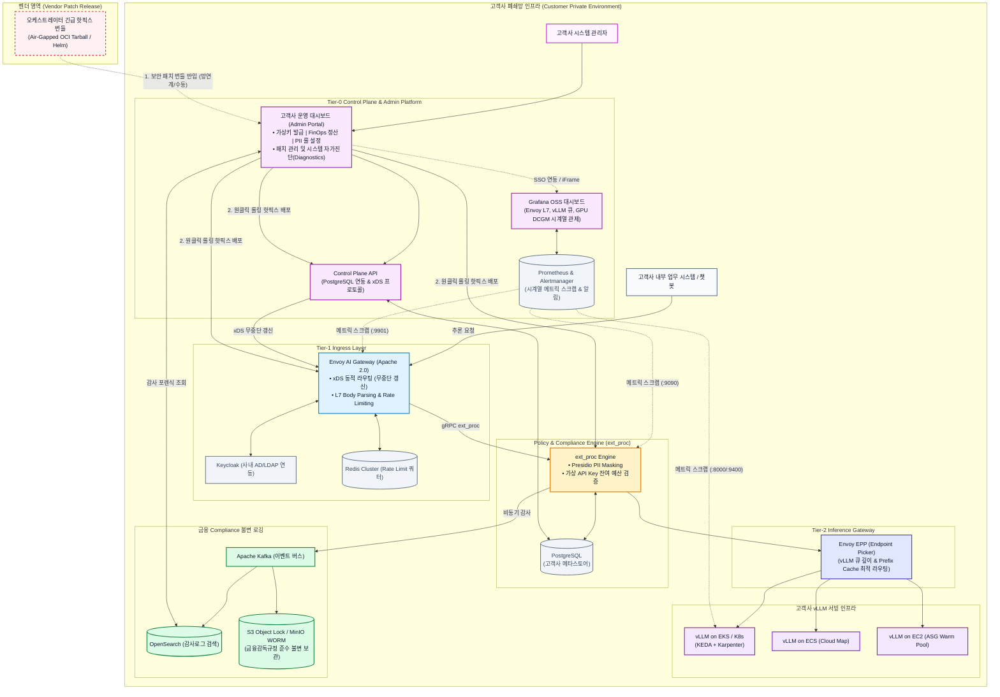

# 상업용 오픈소스 기반 AI 서비스 오케스트레이터 아키텍처 설계서

본 문서는 금융권 및 엔터프라이즈 환경의 엄격한 규제(전자금융감독규정, 개인정보보호법, 망분리 규제)를 준수하며, **고객사 전용 인프라(VPC / 온프레미스)에 100% 완전 독립 설치되어 고객이 직접 운영하는 소프트웨어(Customer-Managed Self-Hosted Appliance)** 아키텍처를 정의합니다.

벤더(솔루션 공급사)는 고객의 내부 데이터나 인프라에 상시 접근하지 않으며, **오케스트레이터 코어 엔진 및 컴플라이언스 모듈에 대한 '긴급 보안 패치 및 무중단 업데이트(Emergency Patch Management)'** 만을 안전하게 공급합니다.

---

## 1. 운영 및 책임 분무 모델 (Shared Responsibility Model)

고객사 설치형 솔루션으로서 고객 IT/보안팀과 솔루션 벤더 간의 명확한 역할과 책임 영역을 정의합니다.

```
┌──────────────────────────────────────────────────────────────────────────────────┐
│                      고객사 전용 인프라 (On-Prem / Private VPC)                  │
│                                                                                  │
│  ┌────────────────────────────────────────────────────────────────────────────┐  │
│  │ 👤 고객사 자체 운영 영역 (Customer Managed)                                    │  │
│  │  • 사용자/부서 계정 및 RBAC 권한 관리 (Keycloak/LDAP 연동)                   │  │
│  │  • 서빙 대상 모델 선정 및 vLLM GPU 인프라 자원 증설 (EKS/ECS/EC2)            │  │
│  │  • 사내 가상 API Key 발급, 부서별 예산 할도 할당 및 FinOps 정산               │  │
│  │  • PII 마스킹 규칙 커스터마이징 및 금융감독원 감사 대응 로그 보관             │  │
│  └────────────────────────────────────────────────────────────────────────────┘  │
│                                       ▲                                          │
│                                       │ (망분리 안전 패치 파이프라인)            │
│  ┌────────────────────────────────────┴───────────────────────────────────────┐  │
│  │ 🛡️ 벤더 관리 영역 (Vendor Provided) - 긴급 패치 & 엔진 릴리즈                │  │
│  │  • 오케스트레이터 코어 엔진(Envoy AI Gateway, ext_proc) 패키징              │  │
│  │  • 보안 취약점(CVE) 긴급 핫픽스 및 오프라인 패치 번들(Air-Gapped Bundle) 제공 │  │
│  │  • 무중단 롤링 업데이트 및 원클릭 롤백(Rollback) 안정성 보장                  │  │
│  └────────────────────────────────────────────────────────────────────────────┘  │
└──────────────────────────────────────────────────────────────────────────────────┘
```

| 구분 | 고객사 IT/보안 운영팀 | 솔루션 공급사 (벤더) |
| :--- | :--- | :--- |
| **운영 주체** | **100% 자체 운영** (설치, 구성, 데이터 백업, 리소스 관리) | 인프라 및 고객 데이터 직접 접근 불가 (망분리 준수) |
| **계정 & 권한** | 사내 사번/AD 연동, 부서별 테넌트 및 가상 API Key 발급 | 솔루션 초기 Admin 기본 계정 템플릿 제공 |
| **모델 & GPU** | 보유 GPU 서버 운영, vLLM 인스턴스 스케일링, 모델 다운로드 | vLLM 연동 가이드 및 Gateway API 매니페스트 제공 |
| **패치 & 유지보수** | 벤더가 전달한 패치 번들을 검증 후 배포 승인/실행 | **긴급 보안 취약점 패치 제작, 릴리즈 노트 및 회귀 테스트 보장** |

---

## 2. 컴포넌트별 오픈소스 기술 스택 및 라이선스

모든 구성 요소는 고객사에 온프레미스로 납품되더라도 소스 코드 공개 의무가 없는 **허용적 오픈소스 라이선스(Apache 2.0, MIT, BSD 등)** 로만 구성됩니다. (AGPLv3인 Grafana 전면 배제)

| 분류 | 컴포넌트 | 라이선스 | 고객사 설치 환경에서의 역할 |
| :--- | :--- | :--- | :--- |
| **Control Plane & Admin Portal** | **Enterprise Admin Console** | 자체 개발 (MIT / Apache 2.0) | • 고객사 관리자용 단일 Web 콘솔 (React/Next.js)<br>• 테넌트 관리, 가상 API Key 발급, FinOps 정산, PII 룰 빌더, 패치 상태 확인 |
| **Control Plane API** | **Orchestrator Management Service** | 자체 개발 (Go / FastAPI) | • 고객사 내부 PostgreSQL 메타스토어 동기화<br>• 정책 변경 시 Envoy AI Gateway에 xDS 동적 프로토콜로 실시간 무중단 배포 |
| **Metrics & Infrastructure Monitoring** | **Prometheus & Grafana** | Apache 2.0 / AGPLv3 (사내 운영) | • **Prometheus**: Envoy L7, ext_proc, vLLM 큐/지연시간, NVIDIA GPU DCGM 메트릭 스크랩<br>• **Grafana**: 3대 사전 탑재 대시보드(트래픽, vLLM/GPU, FinOps), Keycloak SSO 연동 |
| **Audit Log & Forensics Storage** | **OpenSearch & AWS S3 / MinIO** | Apache 2.0 / S3 API | • **비정형 감사 로그 전용**: 실시간 PII 차단 로그 검색(OpenSearch) 및 WORM 불변 보관(S3 Object Lock/MinIO) |
| **Tier-1 Ingress & Gateway** | **Envoy AI Gateway** | Apache 2.0 | • 초저지연 L7 프록시, OIDC 검증, 분산 TPM/RPM Rate Limiting |
| **Identity & Authentication** | **Keycloak** | Apache 2.0 | • 고객사 사내 LDAP / Active Directory 연동<br>• OAuth 2.0 / OIDC 기반 사내 JWT 토큰 검증 및 Grafana SSO 연동 |
| **Distributed Cache** | **Redis Cluster** | BSD 3-Clause | • 고객사 내부 분산 Rate Limiting 카운터 및 슬라이딩 윈도우 쿼터 추적 |
| **Policy & Compliance Engine** | **Custom Service (`ext_proc`)** | 자체 개발 (gRPC) | • Envoy의 `ext_proc` 프로토콜 기반 보안 사이드카<br>• PII 탐지/치환 및 비동기 감사 로그 패키징 |
| **PII Detection & Masking** | **Microsoft Presidio** | MIT | • 금융 민감 정보(주민등록번호, 계좌번호, 카드번호 등) 실시간 탐지/마스킹 |
| **Metadata & Key Store** | **PostgreSQL** | PostgreSQL License | • 고객사 전용 가상 API Key, 부서별 예산 한도, 접근 정책 메타스토어 |
| **Message Streaming** | **Apache Kafka** | Apache 2.0 | • 컴플라이언스 감사 로그의 고성능 비동기 수집 이벤트 버스 |
| **Tier-2 Inference Gateway** | **Envoy EPP (Endpoint Picker)** | Apache 2.0 | • Gateway API Inference Extension (`InferencePool`) 기반<br>• vLLM 큐 깊이 및 KV-Cache 인식 지능형 부하 분산 |
| **Model Serving Engine** | **vLLM** | Apache 2.0 | • 고객사 GPU 인프라에서 구동되는 고속 분산 추론 엔진 |

---

## 3. 전체 시스템 아키텍처 다이어그램 (고객사 자체 완결형)



---

## 4. 벤더의 '오케스트레이터 긴급 패치' 아키텍처 및 전달 방식

고객사가 100% 자체 관리하는 폐쇄망/온프레미스 환경에서 벤더가 솔루션 신뢰성을 유지하고 긴급 취약점(CVE)에 대응하기 위한 패치 메커니즘입니다.

### 4.1 에어갭(Air-Gapped) 오프라인 패치 번들 체계
- **외부 인터넷 연결 배제**: 고객사 망분리 규정상 외부 인터넷(GitHub, Docker Hub 등)에서 직접 `docker pull`을 수행할 수 없습니다.
- **단일 패치 아카이브 공급**:
  - `patch-v1.x.x-hotfix.tar.gz` 형태의 오프라인 패키지 제공
  - 포함 내역: 서명된 OCI 컨테이너 이미지(`tarball`), Helm 차트 변경분(`diff`), DB 마이그레이션 스크립트, 패치 릴리즈 검증 서명키(SHA-256 / GPG 서명)
- **고객사 내부 프라이빗 레지스트리 적재**:
  - 고객사 망연계 솔루션을 통해 반입 후 내부 레지스트리(Harbor, AWS Private ECR, Nexus 등)로 `docker load & push` 지원 스크립트 기본 내장

### 4.2 제로 다운타임(Zero-Downtime) 롤링 패치 메커니즘
- **마이크로서비스 격리 핫스왑**:
  - 추론 프록시(`Envoy AI Gateway`), 컴플라이언스 엔진(`ext_proc`), 컨트롤 플레인(`CP API / Admin UI`)이 완전히 분리된 컨테이너로 배포되어 있습니다.
  - 예: PII 탐지 취약점 패치 시, `ext_proc` 파드만 롤링 업데이트되며 vLLM GPU 추론 인프라나 대시보드는 일체 중단되지 않습니다.
- **K8s 기반 안전 롤링 업데이트**:
  - `PodDisruptionBudget (minAvailable: 1)` 설정으로 상시 가용 인스턴스 보장
  - Envoy 프록시의 Graceful Drain (gRPC 연결 유지 및 신규 트래픽 전환) 적용
- **원클릭 자동 롤백 (Instant Rollback)**:
  - 패치 적용 후 `readinessProbe` 또는 내부 헬스체크 실패 시, 자동으로 이전 안정 버전으로 즉각 롤백

### 4.3 데이터베이스 마이그레이션 호환성 (A/B Backward Compatibility)
- 긴급 패치 시 DB 스키마 변경이 발생하더라도 구버전과 신버전이 동시에 읽고 쓸 수 있는 **Expand & Contract** 마이그레이션 규칙 준수
- 긴급 롤백 시 데이터 손실이나 스키마 충돌이 발생하지 않도록 역방향 호환 스크립트 필수 제공

---

## 5. 고객사 자체 운영을 위한 관리 툴(Admin Portal) 주요 기능

고객사 담당자가 벤더의 도움 없이도 일상적인 운영과 장애 조치를 완결할 수 있도록 특화된 관리 기능입니다.
> 📌 **상세 설계 및 실구현 계획서 참조**: 
> - 화면별 UI/UX 와이어프레임 및 제어 API 명세: [admin_dashboard_design.md](file:///Users/jason/project/오케스트레이터/admin_dashboard_design.md)
> - 소프트웨어 공학 기반 프로덕션 실구현 계획서: [dashboard_engineering_plan.md](file:///Users/jason/project/오케스트레이터/dashboard_arch/dashboard_engineering_plan.md)


### 5.1 패치 및 라이프사이클 관리 탭 (System Lifecycle & Patch Console)
- **현재 컴포넌트 버전 매트릭스 표시**: Envoy, ext_proc, Presidio, Control Plane의 현재 구동 버전과 보안 권고 상태 시각화
- **오프라인 패치 번들 업로드**:
  - 관리자 UI에서 반입된 패치 번들(`tar.gz`)을 업로드하면 무결성(Checksum/Signature) 자동 검증
  - [드라이런(Dry-Run)] 모드로 사전 영향도 테스트 후 [원클릭 핫픽스 적용] 지원
- **롤백 관리자**: 최근 배포 히스토리 보관 및 유사시 '이전 버전으로 복원' 원클릭 트리거

### 5.2 자가 진단 및 서포트 번들 (Self-Diagnostics & Support Bundle)
- **원클릭 사전 점검 (Pre-Flight Health Check)**:
  - PostgreSQL 연결성, Redis 쿼터 지연시간, Kafka 버퍼 상태, vLLM 노드 응답성 자동 점검
- **민감정보 배제형 서포트 번들 생성 (Zero-PII Support Bundle)**:
  - 고객사에서 긴급 기술 지원이 필요할 때, 사내 프롬프트나 개인정보(PII)는 **완벽히 마스킹/제외**하고, 오직 오케스트레이터의 에러 스택트레이스, Envoy 설정 상태, 시스템 리소스 메트릭만 암호화된 ZIP 파일로 추출
  - 고객사는 보안성 검토 후 해당 ZIP 파일만 벤더에게 전달하여 안전하게 원격 분석 요청 가능

### 5.3 테넌트/가상키 및 FinOps 거버넌스
- **사내 부서/프로젝트별 가상 API Key 발급**: 모델 접근 권한 및 RPM/TPM 속도 제한
- **예산 통제 (Hard Cap)**: 부서별 월간 한도 초과 시 자동 차단하여 GPU 자원 독점 방지
- **사내 결산용 비용 정산 리포트**: 부서별 토큰 사용 통계 CSV 내보내기

### 5.4 컴플라이언스 및 PII 룰 커스터마이징
- 사내 보안 규정에 맞춘 주민번호, 사번, 계좌번호 정규식 튜닝
- 금융감독원 실태 점검 시 즉시 제출 가능한 감사 로그 검색 및 증적 출력

---

## 6. 오프라인 라이선스 검증 메커니즘 (Air-Gapped Licensing)

외부 통신이 차단된 고객사 환경에서 상업적 권한 및 유효성을 검증하는 방식입니다.

- **비대칭 암호화 서명 (RSA-4096 / ED25519)**:
  - 벤더는 고객사의 고유 식별자(사내 라이선스 ID, 허용 최대 GPU 노드 수, 만료일)를 개인키로 서명하여 발급
  - 고객사 오케스트레이터는 내장된 벤더 공개키(Public Key)로 오프라인에서 무결성 검증
  - **외부 라이선스 서버와의 콜백(Phone Home) 통신이 일체 불필요**하여 망분리 보안 규정 100% 만족

---

## 7. 핵심 배포 및 패치 매니페스트 예시

### 7.1 무중단 긴급 롤링 패치를 위한 Deployment & PDB
```yaml
apiVersion: apps/v1
kind: Deployment
metadata:
  name: orchestrator-ext-proc
  namespace: ai-gateway
spec:
  replicas: 3
  strategy:
    type: RollingUpdate
    rollingUpdate:
      maxSurge: 1        # 패치 시 1대 추가 생성 후 이전 파드 제거
      maxUnavailable: 0  # 서비스 가용성 100% 유지
  selector:
    matchLabels:
      app: orchestrator-ext-proc
  template:
    metadata:
      labels:
        app: orchestrator-ext-proc
    spec:
      containers:
        - name: ext-proc-engine
          # 고객사 내부 프라이빗 레지스트리 이미지 경로
          image: internal-registry.customer.co.kr/ai-gateway/ext-proc:v1.2.1-hotfix
          readinessProbe:
            grpc:
              port: 9002
            initialDelaySeconds: 3
            periodSeconds: 5
---
apiVersion: policy/v1
kind: PodDisruptionBudget
metadata:
  name: ext-proc-pdb
  namespace: ai-gateway
spec:
  minAvailable: 2 # 롤링 패치 중에도 최소 2대 상시 트래픽 처리
  selector:
    matchLabels:
      app: orchestrator-ext-proc
```
